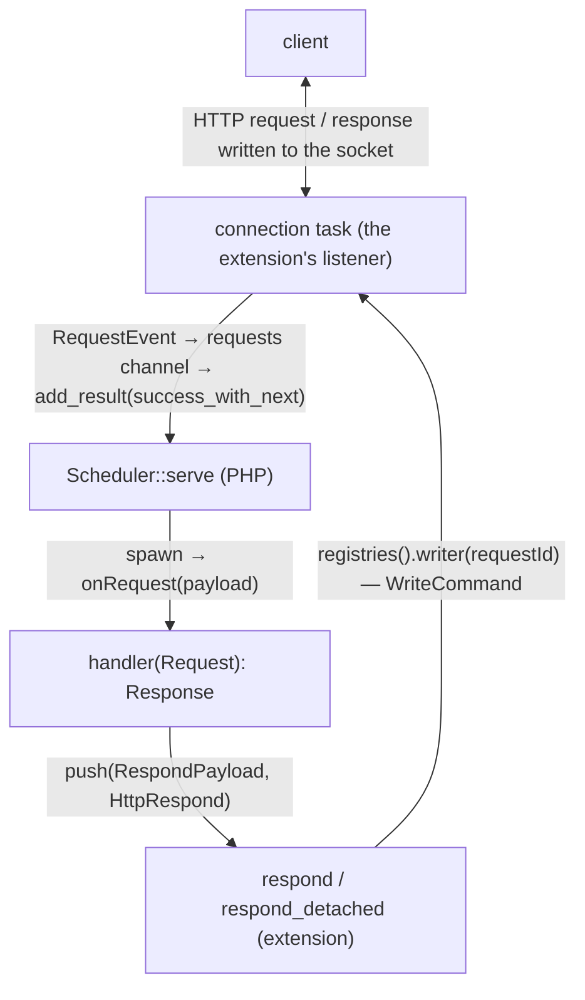

English | [Русский](adding-a-server.ru.md)

# How to add a new server

A server is a special kind of [feature](adding-a-feature.md): a long-lived network
listener that lives in the extension, accepts incoming connections and streams every
event into PHP, which handles it in a separate coroutine (a closure the scheduler
runs in a PHP Fiber of its own) and sends the response back. It inverts an
ordinary feature: rather than PHP calling the extension and waiting for a result,
the extension hands PHP a stream of incoming requests.

The reference to copy is `HttpServer` (`src/Features/HttpServer/`,
`ext/src/features/httpserver/`). `SocketServer` follows the same pattern, and
the code shared by both is already extracted into a trait; `WsServer` is a hybrid —
the listener and handshake from `HttpServer`, the push model of `SocketServer`
after the upgrade.

Read [how to add an ordinary feature](adding-a-feature.md) first — a server reuses
its mechanics (`Method`, payloads, the state/streaming registry, `next()`) and adds
a network layer and a serving loop on top. See also the
[HTTP server](http-server.md) and [worker master](worker-master.md) docs.

## Model: two `Method`s per server

A server is a pair of methods, both served by one feature (matched on `Method`):

- `<Server>Serve` — open the listener and stream accepted requests into PHP (a
  self-pumping stream: the serve task in the extension publishes each request as the
  next stream result, no per-request `next()` crossing);
- `<Server>Respond` — deliver one response record (whole, or head/chunk/end of a
  stream) from the PHP handler back to the waiting connection.

Reference: `HttpServe` (`hs`) + `HttpRespond` (`hr`), both → the httpserver
feature. Both values are mirrored in PHP `MethodEnum` and Rust
`ext/src/types/method.rs`, and registered in `ext/src/features/mod.rs` with one arm
for both:

```rust
Method::HttpServe | Method::HttpRespond => Ok(httpserver::get()),
```



## Mandatory requirements

Besides the two general feature requirements (context cancellation and execution
deadline), a server has its own:

1. The cancellation token of the `Serve` task (its flow — the group of tasks the
   server owns in the extension) is the server's lifetime. Cancelling the flow
   (`stopFlow`) ends the accept loop and the stream that publishes the requests.
   In `HttpServer` a further request on an open connection then gets `503`, and a
   request already accepted waits for its handler until `handlerTimeoutMs` runs
   out (`504`); in `SocketServer` and `WsServer` every connection task also selects
   on the token and ends at once.
   **No request may outlive the server's stop by more than its handler timeout.**
2. A per-request limit, not only a per-server one. In `HttpServer` each handler is
   also bounded by `handlerTimeoutMs` inside the extension (a timer in the
   connection task, firing independently of PHP): before the first write the client
   gets a `504`, after the stream has started the response is aborted. A server
   without requests (socket, WS) bounds a connection handler only through
   `Scheduler::serve(handlerTimeoutMs:)` on the PHP side.
3. Graceful shutdown and orphaned workers. A server must be able to stop
   accepting new connections without touching the ones already accepted, so the
   other workers on the port take the new ones, and to self-terminate if its
   master died (`masterPid`, or the master of `WorkerContext`).

## Payloads

Written like an ordinary feature's (mirrored, `serde(rename)` = the short keys,
cross-references). A server needs at least three:

1. `ServePayload` — the listener address plus settings (timeouts in ms, limits in
   bytes, `reusePort`, and `listenFd` — the descriptor of a listening socket bound
   elsewhere, accepted on instead of binding the address; the server fills it from an
   `fd://N` address, see `listenerDescriptor()`).
2. `RespondPayload` — one response record. The `op` field selects the record kind;
   for `HttpServer` these are `OP_FULL`(0) / `OP_HEAD`(1) / `OP_CHUNK`(2) /
   `OP_END`(3), built by the factories `RespondPayload::full()/head()/chunk()/end()`.
   Headers are normalized to `array<string, list<string>>`.
3. `RequestEvent` — what the extension streams into PHP per request (an
   extension-side struct only; PHP decodes it straight into the handler's request
   object). It carries `requestId`, the method, path, query, headers and the whole
   body, read before the event is sent.

> `requestId` is the end-to-end identifier: the extension generates it on accept
> (`flowKey:r:<n>`), puts it into `RequestEvent`, PHP returns it in every
> `RespondPayload`, and the extension uses it to find the waiting connection. Make it unique
> within a flow.

## PHP side

The shape of the request/response is up to you. The HTTP server exposes PSR-7
outward (the request is assembled from `RequestEvent` in
`HttpServer::decodeRequest()` via an injected PSR-17 factory; the body is
`Dto/RequestBodyStream` over `Dto/RequestBody`), while the socket and WS servers
use their own DTO — `Dto/Connection` (on `Socket\Dto\AbstractConnection`) with
`read()`/`write()`/`close()` for the push model. In both cases the response is
encoded into `RespondPayload`. The records of a streamed response
(head/chunk/end) are acknowledged back, which is what keeps a handler from
outrunning the client. The one-shot full response of the HTTP server awaits no
result: `RespondPayload::full()` sets the no-result flag (`nr`) and goes through
`FeatureExecutor::execNoResult()`, which pushes it detached (with an empty flow
key), so the coroutine finishes without waiting for the write (the socket and WS
servers acknowledge every command).

Argv parsing, arming automatic preemption and the lifecycle log are already
extracted into the stateless `SConcur\Features\Server\ServerRuntimeSupportTrait`:

- `parseArgs(array $argv): array` — collect the scalar (`int`/`bool`/`float`/
  `string`) constructor parameters by reflection, coerce each `--name=value` string
  to the type and throw `InvalidServerArgumentException` on an unknown argument;
- `fromEnvironment(string $value, string $name, string $unset = ''): string` — a
  telemetry setting as the server runs with it: its own, or the environment's when it
  was left at `$unset` (the master puts the socket and the pool's name there);
- `withPreemption(int $quantumMs, Closure $callback): mixed` — run the callback with
  automatic preemption armed and disarm it afterwards. A server passes its quantum to
  `Scheduler::serve()` instead and needs this only if it has no serve loop of its own;
- `logServerEvent(string $message): void` — one timestamped line about the worker's own
  lifecycle, on stdout;
- `listenerDescriptor(string $address, bool $reusePort): ?int` — the descriptor an
  `fd://N` address hands over, or null for an address to bind; it throws
  `InvalidServerArgumentException` on a malformed `fd://` and on `reusePort` beside one.

The stop check is `SConcur\Features\Server\StopRequest`.
`StopRequest::watch(?int $masterPid)` starts watching SIGTERM/SIGINT and returns the
object whose `isRequested(...)` is passed as the serve loop's `shouldStop`; it
also says yes once the master is no longer the parent — the `masterPid` given, or the
master of `WorkerContext::current()` under one — which survives PID reuse
because the kernel reparents the process once the master dies. Release it in
`finally`. It needs nothing but this extension — no ext-pcntl, no ext-posix — and
asks it at most every 100 ms.

A new server just uses the trait. To be runnable from a script on its own it adds a
static `fromArgs()` modelled on `HttpServer::fromArgs()`: call `self::parseArgs($argv)`,
add `onError` if present, unpack into the constructor. A master's role uses the
constructor.

The public `serve(Closure $handler)` then generates a `flowKey`, starts
`StopRequest::watch()` (released in `finally`), starts the listener with
`Extension::get()->push($flowKey, new ServePayload(...))` — a streaming task whose
batches are the incoming requests — and hands control to the shared
`Scheduler::get()->serve(...)`, passing:

- `serverFlowKey`/`serverTaskKey` — the listener stream keys;
- `maxRequests` — finish cleanly after N requests;
- `onRequest(array $payload)` — receives the request event the core built and runs
  in a coroutine of its own per request: decode, call the handler, send the
  response (`HttpServer::handle()` in the reference);
- `shouldStop(): bool` — a signal arrived or the worker is orphaned;
- `onDrainStart()` — called once when the shutdown begins: stop accepting early
  via `Extension::get()->httpStopAccepting($flowKey)`, so new connections go to
  the other workers on the port;
- `onShutdownStep(string $step)` — each graceful-shutdown step in words, for the worker
  to log;
- `preemptionQuantumMs` — arm automatic preemption for as long as the loop serves, so a
  CPU-bound handler cannot starve the others (`0` disables), see
  [coroutine switching](coroutine-switching.md);
- `handlerTimeoutMs` — how long one handler coroutine may run before it is unwound where
  it stands (`0` disables), see [coroutine timeout](coroutine-timeout.md). Preemption is
  what lets that deadline reach a handler that never waits;
- `drainsToStreamEnd` — whether the stop lasts until the server's stream ends rather
  than until no handler is in flight. The HTTP server passes `true`: its core ends the
  stream once every connection has written its last response and closed (or
  `shutdownTimeoutMs` has passed), and meanwhile the loop handles what still arrives on
  them, so the worker never leaves with a response on its way out. A server whose core
  does not end the stream on its own leaves it at `false`.

`Scheduler::serve` itself multiplexes the incoming requests and the async work
of their handlers in a single wait loop (`waitAnyTimeoutBatch`) and on shutdown
closes the flow down cleanly (`stopFlow`). This mechanic is shared and does not
need rewriting.

## Extension side

`ext/src/features/<server>/mod.rs` implements the `Feature` trait, and its
`handle` dispatches on the message's `Method` into `handle_serve()` and the respond
handler (`respond()` in `httpserver`, `handle_respond()` in the socket and WS
servers). The feature itself is a unit struct behind a `OnceLock`; its state lives
in a `Registries` struct owned by the core (`ext/src/core.rs`), so a fork discards
it with everything else. Two maps: `pending_requests` (`requestId` → the channel its
connection task reads write commands from — global, because a respond arrives on a
different flow than the request) and `server_states` (`flowKey` → `ServerState`,
so stop-accepting can find the listener).

`handle_serve` parses `ServePayload`, opens the listener (`listen::open()` in
`listen.rs`: binds the address, with `SO_REUSEPORT` when asked, or takes over the
`listenFd` descriptor), registers the `ServerState`, spawns the accept loop and then
runs the self-pumping stream as the serve task's own body: every accepted request is
published as the next result of the serve task, until the flow is cancelled. This
request stream bypasses the `states` registry — that one serves only the secondary
streams (the inbound message streams). A fast side cannot outrun a slow one at any
layer: publishing a result waits on the shared results buffer, the requests channel
buffers accepts, and beyond that the connection task itself waits.

The accept loop (`accept_loop()` in `server.rs`) spawns a task per connection. Its
per-request service (the `service_fn` closure there) takes a `maxConcurrency` permit,
and `serve_request()` then reads the body — so a request waiting for a slot does not
hold a body buffer —, registers the request in `pending_requests`, sends a
`RequestEvent` into the requests channel and waits for write commands from PHP,
applying them to the socket. On the handler timeout or a disconnect it drops the
pending entry (`PendingGuard`), so a late response does not hang forever, and it
writes the access-log line on the extension side.

`respond()` decodes the whole `RespondPayload`; if that fails, it decodes only the
`requestId` (`RespondRequestId`) and answers that connection with a `500`, so a
corrupt payload does not leave the client hanging. Otherwise it finds the pending
request and hands over the write command, waiting for it to be applied — the
handler coroutine continues only once the bytes have gone into the socket, or the
request is gone.

The full write (`nr`) arrives as a detached push. The core runs it through the
feature's `handle_detached()` on the PHP thread, inside the `push()` call, so it
must not block, and the core only takes a detached push for a method listed in
`detachable()` (`ext/src/handler/mod.rs`; `HttpRespond` and `Amqp` today). The HTTP
server's `respond_detached()` puts the command into the connection's one-slot
channel with `try_send` and publishes no result. A new server that sends a
no-result write needs both.

## The C export `StopAccepting`

The shared exports (`push`, `next`, `stopFlow`, `waitAnyBatch`,
`waitAnyTimeoutBatch`) are reused as they are. A server additionally needs its own
export for the early stop of accepting — each server keeps its listeners in a map of
its own (`server_states` in `httpserver`, `servers` in the socket and WS servers), so
another server's `httpStopAccepting` cannot be reused (cf. `socketStopAccepting`).
Add `<server>StopAccepting` along the same chain:

- `ext/src/lib.rs` — the `#[unsafe(no_mangle)] pub extern "C"` function that
  calls into the feature inside `guarded()`, and returns at once while
  `core::built()` is `None`;
- `ext/include/sconcur_core.h` — its declaration, which the C glue
  (`ext/sconcur.c`) links against;
- `ext/sconcur.c` — `PHP_FUNCTION`, `arginfo`, the `ZEND_NS_FE` registration and the
  line in the list of exports in the file's header comment;
- `ext/sconcur.stub.php` — the function declaration;
- `src/Connection/Extension.php` — `use function` plus a PHP wrapper.

The feature's `stop_accepting(flow_key)` finds the `ServerState` in
`server_states` and cancels its `stop_accepting` token, which ends the accept loop
and nothing else — the requests already accepted are untouched. In a `SO_REUSEPORT`
pool the kernel immediately hands new connections to the other workers, and on a
shared `fd://` socket the other workers keep accepting from it, while this
process finishes its own. The HTTP server goes further: once accepting stops it takes
what is queued on its own socket (`Listener::take_queued()`), answers every request
with `Connection: close` and shuts down a connection still open a second after the stop
(`serve_connection()` in `server.rs`) — see
[graceful shutdown](http-server.md#graceful-shutdown).

This is a protocol change, so the extension-version rule applies (bump at most once
per branch, see [.ai/README.md](../.ai/README.md)).

> A minimal server can do without `StopAccepting` and tear everything down via
> `stopFlow`, but then the connections it has not accepted yet are not left to the
> other workers on the port — a server under a master needs it.

## Integration with the worker master

A server runs under the worker master for free if it honours the contract: a group's
role builds it and calls `serve()`; the server watches the master through
`StopRequest::watch()` (which falls back to `WorkerContext`), reads its telemetry
settings from the environment the master sets, and says it is up from its serve loop
(`Scheduler::serve()` does that). Several workers share the port through
`reusePort: true`. Details in [Worker master](worker-master.md).

## Statistics

To collect and report statistics out of the box, plug in the neutral
`ext/src/stats/` module — a process-metrics sampler plus a best-effort `Pusher`
that sends snapshots to the master's collector; aggregation and the panel are the
master's job (`src/Telemetry`), see [Server statistics](admin-stats.md).

PHP side: `ServePayload` += `telemetrySocket`/`serverName`/`telemetryIntervalMs`
(keys `ts`/`sn`/`ti`), the constructor += the same three parameters, and `serve()`
passes each through `self::fromEnvironment()`, which falls back on the env the master
sets when telemetry is enabled.

Extension side: add a workload counter implementing `stats::WorkloadProvider`
(`RequestStats` for HTTP, `ConnectionStats` for the socket and WebSocket pairs)
and increment it in the connection/request handler; thread the three telemetry
fields through the server config; build the pusher with
`Pusher::start(name, telemetry_socket, interval_ms, start_time, provider)` and
keep it in the server state. `Pusher::disabled()` covers a server started
without a collector, and dropping the pusher withdraws it from the process-wide
push loop (the last one out stops the loop), so nothing has to be stopped by hand.

## Tests (mandatory)

Bring up a real server process on loopback and send requests to it with `curl` — the
infrastructure reference is `tests/impl/HttpServer/TestHttpServer.php` (spawn via
`proc_open`, a free port, reading the access log) plus
`tests/feature/Features/HttpServer/BaseHttpServerTestCase.php`. Cover a basic
request/response, streaming, `maxConcurrency`, `handlerTimeoutMs` (including a
natively-blocking handler), graceful shutdown, `SO_REUSEPORT` (two servers on one
port), a shared `fd://` socket, `maxRequests` and orphan self-termination. Logic the
PHP suites can only catch statistically — a race whose window is microseconds wide
— goes into the core's own unit tests (`#[cfg(test)] mod tests` beside the code,
run by `make ext-test`), and the end-to-end scenario under the master is
`tests/feature/Worker/WorkerMasterTest.php`.

## Checklist

PHP:

- [ ] `MethodEnum` — two values (`<Server>Serve`, `<Server>Respond`).
- [ ] Payloads: `ServePayload`, `RespondPayload` (+ cross-references
      `Rust: payloads::<Type>`).
- [ ] Request/response shape: your own DTOs or PSR-7 outward.
- [ ] `use ServerRuntimeSupportTrait;` —
      `parseArgs`/`fromEnvironment`/`logServerEvent`/`listenerDescriptor`;
      `StopRequest::watch()` for `shouldStop`.
- [ ] `fromArgs()` via `self::parseArgs($argv)`, accepting `--masterPid` and
      `--address` (`fd://N` included), for a script that runs the server on its own.
- [ ] `serve()`: start the listener via `push(ServePayload)` plus
      `Scheduler::serve(...)` with `onRequest`/`shouldStop`/`onDrainStart`/
      `onShutdownStep`, and the `preemptionQuantumMs`/`handlerTimeoutMs` the
      constructor took.
- [ ] Statistics: `ServePayload` += `ts`/`sn`/`ti`, constructor += 3 parameters,
      each passed through `self::fromEnvironment()` in `serve()`.
- [ ] Tests from a `BaseHttpServerTestCase` analogue (a real process + `curl`).

Rust:

- [ ] The same two constants in `ext/src/types/method.rs` (variants plus arms in
      `from_wire()`, `as_wire()`, `as_php_case()`).
- [ ] Payload structs in `payloads.rs`, mirroring PHP 1:1, plus `RequestEvent` and
      its `into_value()`.
- [ ] The feature: `handle` matches on the method → `handle_serve` (bind → the
      server state → the self-pumping stream) and the respond handler (hand-over
      by `requestId`, waiting for the write to be applied).
- [ ] A no-result write (`nr`): `handle_detached()` on the feature and the method
      in `detachable()` (`ext/src/handler/mod.rs`).
- [ ] The server-state and pending-request registries; `stop_accepting(flow_key)`;
      `httpserver::listen::open()` for `SO_REUSEPORT` and an `fd://` socket, the one
      listener every server opens.
- [ ] The flow's cancellation token honoured; for a request-based server,
      `handlerTimeoutMs` in the connection task and the access log written on the
      extension side.
- [ ] Statistics: a workload counter, a `stats::Pusher` started with the server
      state and dropped with it.
- [ ] Registration in `ext/src/features/mod.rs` (one arm for both methods).

Boundary / protocol:

- [ ] `<server>StopAccepting` along the chain `lib.rs` → `sconcur_core.h` →
      `sconcur.c` → `sconcur.stub.php` → `Extension.php`; account for the
      extension version (bump once per branch).

Check: `make check` (runs `cs-fixer-check`, `php-stan`, `ext-build`, `ext-test`,
`ext-check` and `test`).
