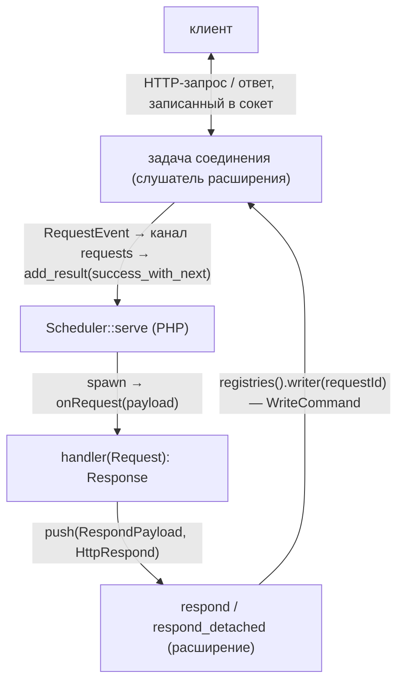

[English](adding-a-server.md) | Русский

# Как добавить новый сервер

Сервер — это особый вид [фичи](adding-a-feature.ru.md): долгоживущий сетевой
слушатель, который живёт в расширении, принимает входящие соединения и передаёт потоком каждое
событие в PHP, а тот обрабатывает его в отдельной корутине (замыкании, которое
планировщик выполняет в собственном PHP Fiber) и отправляет ответ обратно. Это
инверсия обычной фичи: не PHP зовёт расширение и ждёт результат, а расширение отдаёт
PHP поток входящих запросов.

Образец для копирования — `HttpServer` (`src/Features/HttpServer/`,
`ext/src/features/httpserver/`). `SocketServer` построен по тому же паттерну,
а общий для обоих код уже вынесен в трейт; `WsServer` — гибрид: слушатель и
рукопожатие от `HttpServer`, push-модель `SocketServer` после перехода соединения
на WebSocket.

Сначала прочитайте [как добавить обычную фичу](adding-a-feature.ru.md) — сервер
переиспользует её механику (`Method`, payload'ы, реестр состояний и стриминга,
`next()`) и добавляет сверху сетевой слой и цикл обслуживания. См. также
документацию [HTTP-сервера](http-server.ru.md) и [мастера воркеров](worker-master.ru.md).

## Модель: два `Method` на сервер

Сервер — это пара методов, которые обслуживает одна фича (по совпадению с
`Method`):

- `<Server>Serve` — поднять слушатель и передавать потоком принятые запросы в PHP
  (самокачающийся поток: serve-задача в расширении публикует каждый запрос очередным
  результатом стрима, без `next()`-перехода на запрос);
- `<Server>Respond` — доставить одну запись ответа (целиком либо head/chunk/end
  стрима) из PHP-обработчика обратно в ждущее соединение.

Образец: `HttpServe` (`hs`) + `HttpRespond` (`hr`), оба →
фичу httpserver. Оба значения зеркалятся в PHP `MethodEnum` и Rust
`ext/src/types/method.rs` и регистрируются в `ext/src/features/mod.rs` одной веткой
на оба:

```rust
Method::HttpServe | Method::HttpRespond => Ok(httpserver::get()),
```



## Обязательные требования

Помимо двух общих требований к фиче (отмена по контексту и предельное время
выполнения), у сервера есть свои:

1. Токен отмены задачи `Serve` (её флоу — группы задач, которой сервер владеет в
   расширении) — это время жизни сервера. Отмена флоу (`stopFlow`) завершает цикл
   приёма и поток, публикующий запросы. В `HttpServer` следующий запрос по открытому
   соединению после этого получает `503`, а уже принятый запрос ждёт свой обработчик,
   пока не истечёт `handlerTimeoutMs` (`504`); в `SocketServer` и `WsServer` каждая
   задача соединения тоже ждёт этот токен в `select!` и завершается сразу.
   **Ни один запрос не должен пережить остановку сервера дольше, чем на таймаут
   обработчика.**
2. Лимит на запрос, а не только на сервер. Каждый обработчик ограничен
   `handlerTimeoutMs` на стороне расширения (таймер в задаче соединения, срабатывает
   независимо от PHP): до первой записи клиент получает `504`, после начала
   стрима ответ обрывается.
3. Штатная остановка и осиротевшие воркеры. Сервер обязан уметь перестать
   принимать новые соединения, не трогая уже принятые, чтобы новые забрали другие
   воркеры на том же порту, и самозавершаться, если умер его мастер
   (`--masterPid`).

## Payload'ы

Пишутся как у обычной фичи (зеркально, `serde(rename)` = короткие ключи,
перекрёстные ссылки). Серверу нужны минимум три:

1. `ServePayload` — адрес слушателя плюс настройки (таймауты в мс, лимиты в байтах,
   `reusePort` и `listenFd` — слушающий сокет, открытый в другом месте, на котором
   сервер принимает соединения вместо привязки к адресу).
2. `RespondPayload` — одна запись ответа. Поле `op` выбирает вид записи; у
   `HttpServer` это `OP_FULL`(0) / `OP_HEAD`(1) / `OP_CHUNK`(2) / `OP_END`(3),
   которые строят фабрики `RespondPayload::full()/head()/chunk()/end()`. Заголовки
   нормализуются к `array<string, list<string>>`.
3. `RequestEvent` — то, что расширение стримит в PHP на каждый запрос (структура
   только на его стороне; PHP декодирует её прямо в объект запроса обработчика).
   Она несёт `requestId`, метод, путь, query, заголовки и всё тело, прочитанное до
   отправки события.

> `requestId` — сквозной идентификатор: расширение генерирует его при приёме
> (`flowKey:r:<n>`), кладёт в `RequestEvent`, PHP возвращает его в каждом
> `RespondPayload`, и расширение по нему находит ждущее соединение. Он должен быть
> уникален внутри флоу.

## Сторона PHP

Форма запроса и ответа — на ваше усмотрение. HTTP-сервер отдаёт наружу PSR-7
(запрос собирается из `RequestEvent` в `HttpServer::decodeRequest()` через
переданную PSR-17 фабрику; тело — `Dto/RequestBodyStream` поверх
`Dto/RequestBody`), а сокет- и WS-серверы используют свой DTO —
`Dto/Connection` (на основе `Socket\Dto\AbstractConnection`) с
`read()`/`write()`/`close()` для push-модели. В обоих случаях ответ кодируется в
`RespondPayload`. Записи стримингового ответа (head/chunk/end) подтверждаются
обратно — это и не даёт обработчику обогнать клиента. Цельный ответ HTTP-сервера
результата не ждёт: `RespondPayload::full()` выставляет флаг «без результата»
(`nr`) и уходит через `FeatureExecutor::execNoResult()`, который отправляет его
отдельно от флоу (с пустым ключом флоу), так что корутина завершается, не дожидаясь
записи (сокет- и WS-серверы подтверждают каждую команду).

Разбор argv, включение автоматической преемпции и лог жизненного цикла уже вынесены
в трейт без состояния `SConcur\Features\Server\ServerRuntimeSupportTrait`:

- `parseArgs(array $argv): array` — собрать скалярные (`int`/`bool`/`float`/
  `string`) параметры конструктора рефлексией, привести каждую строку
  `--name=value` к типу и бросить `InvalidServerArgumentException` на неизвестном
  аргументе;
- `applyTelemetryEnvironment(array $overrides): array` — прочитать переменные
  окружения телеметрии;
- `withPreemption(int $quantumMs, Closure $callback): mixed` — выполнить колбэк с
  включённой автоматической преемпцией и выключить её после. Сервер вместо этого
  передаёт свой квант в `Scheduler::serve()`, а это нужно только тому, у кого нет
  своего цикла обслуживания;
- `logServerEvent(string $message): void` — одна строка с меткой времени о
  жизненном цикле самого воркера, в stdout;
- `describeListener(string $address, ?int $listenFd): string` — слушатель так, как
  его называет стартовая строка: адрес или `fd N` для переданного серверу сокета.

Проверка остановки — `SConcur\Features\Server\StopRequest`.
`StopRequest::watch(?int $masterPid)` начинает слушать SIGTERM/SIGINT и возвращает
запрос, который читает `shouldStop` серверного цикла (`$stopRequest->isRequested(...)`);
он отвечает «да» и тогда, когда мастер перестал быть родителем, — это устойчиво к
переиспользованию PID, потому что после смерти мастера ядро меняет родителя.
Освобождается в `finally`. Нужно только это расширение — ни ext-pcntl, ни ext-posix —
и спрашивает его не чаще раза в 100 мс.

Новому серверу достаточно подключить трейт, а чтобы запускаться под
`bin/sconcur-server`, он добавляет статический `fromArgs()` по образцу
`HttpServer::fromArgs()`: вызвать `self::parseArgs($argv)`, добавить `onError`,
если он есть, и распаковать в конструктор.

Публичный `serve(Closure $handler)` затем генерирует `flowKey`, запускает
`StopRequest::watch()` (освобождая его в `finally`), поднимает слушатель через
`Extension::get()->push($flowKey, new ServePayload(...))` — это стриминговая
задача, батчи которой и есть входящие запросы — и передаёт управление общему
`Scheduler::get()->serve(...)`, передав:

- `serverFlowKey`/`serverTaskKey` — ключи потока слушателя;
- `maxRequests` — штатно завершиться после N запросов;
- `onRequest(array $payload)` — получает событие запроса, собранное ядром, и
  выполняется в собственной корутине на каждый запрос: декодировать, вызвать
  обработчик, отправить ответ (в образце это `HttpServer::handle()`);
- `shouldStop(): bool` — пришёл сигнал или воркер осиротел;
- `onDrainStart()` — вызывается один раз в начале остановки: заранее перестать
  принимать через `Extension::get()->httpStopAccepting($flowKey)`, чтобы новые
  соединения ушли другим воркерам на том же порту;
- `onShutdownStep(string $step)` — каждый шаг штатной остановки словами, чтобы воркер
  их записал;
- `preemptionQuantumMs` — включить автоматическую преемпцию на всё время работы цикла,
  чтобы обработчик, занятый вычислениями, не отнял процессор у остальных (`0` —
  выключено), см. [переключение корутин](coroutine-switching.ru.md);
- `handlerTimeoutMs` — сколько корутина одного обработчика может работать, прежде чем её
  размотают на месте (`0` — выключено), см. [таймаут корутины](coroutine-timeout.ru.md).
  Именно преемпция даёт этому сроку достать обработчика, который ничего не ждёт.

`Scheduler::serve` сам мультиплексирует входящие запросы и асинхронную работу их
обработчиков в одном цикле ожидания (`waitAnyTimeoutBatch`), а при остановке
штатно гасит флоу (`stopFlow`). Эта механика общая и переписывать её не нужно.

## Сторона расширения

`ext/src/features/<server>/mod.rs` реализует трейт `Feature`, а его `handle`
диспетчеризует по `Method` сообщения в `handle_serve()` и обработчик ответа
(`respond()` в `httpserver`, `handle_respond()` в сокет- и WS-серверах). Сама фича —
unit-структура за `OnceLock`; её состояние живёт в `Registries`, которым владеет
ядро (`ext/src/core.rs`), поэтому форк выбрасывает его вместе со всем остальным.
Две карты: `pending_requests` (`requestId` → канал, из которого задача соединения
читает команды записи, — глобальная, потому что respond приходит на другом флоу,
не на том, где пришёл запрос) и `server_states` (`flowKey` → `ServerState`, чтобы
остановка приёма нашла слушатель).

`handle_serve` парсит `ServePayload`, открывает слушатель (`listen::open()` в
`listen.rs`: привязывается к адресу, с `SO_REUSEPORT`, когда просят, или забирает
`listenFd`), регистрирует `ServerState`, запускает задачу цикла приёма и дальше
сама выполняет самокачающийся поток: каждый принятый запрос публикуется очередным
результатом serve-задачи, пока флоу не отменят. Этот поток запросов обходит реестр
`states` — тот обслуживает только вторичные стримы (входящие потоки сообщений).
Быстрая сторона не может обогнать медленную ни на одном уровне: публикация
результата ждёт общий буфер результатов, канал запросов буферизует приёмы, а дальше
ждёт уже сама задача соединения.

Цикл приёма (`accept_loop()` в `server.rs`) запускает задачу на каждое соединение.
Её обработка запроса (`serve_request()`) берёт разрешение `maxConcurrency` до
чтения тела — чтобы запрос, ждущий слот, не держал буфер тела, — регистрирует
запрос в `pending_requests`, отправляет `RequestEvent` в канал запросов и ждёт от
PHP команд записи, применяя их к сокету. По таймауту обработчика или при обрыве она
снимает запись (`PendingGuard`), так что поздний ответ не висит вечно, и пишет
строку access-лога на стороне расширения.

`respond()` декодирует весь `RespondPayload`; если это не удалось, он декодирует
только `requestId` (`RespondRequestId`) и отвечает этому соединению `500`, чтобы
испорченный payload не оставил клиента ждать. Иначе он находит ожидающий запрос и
передаёт команду записи, дожидаясь её применения: корутина-обработчик продолжается
только после того, как байты ушли в сокет, или запроса уже нет.

Полная запись (`nr`) приходит как push без флоу. Ядро выполняет её через
`handle_detached()` фичи в PHP-потоке, внутри вызова `push()`, поэтому она не должна
блокироваться, и ядро принимает такой push только для метода из списка
`detachable()` (`ext/src/handler/mod.rs`; сейчас это `HttpRespond` и `Amqp`).
`respond_detached()` HTTP-сервера кладёт команду в одноместный канал соединения
через `try_send` и не публикует результат. Новому серверу с записью без результата
нужно и то, и другое.

## C-экспорт `StopAccepting`

Общие экспорты (`push`, `next`, `stopFlow`, `waitAnyBatch`, `waitAnyTimeoutBatch`)
переиспользуются как есть. Дополнительно серверу нужен собственный экспорт для
раннего прекращения приёма — каждый сервер держит свои слушатели в своей карте
(`server_states` в `httpserver`, `servers` в сокет- и WS-серверах), поэтому
`httpStopAccepting` чужого сервера не переиспользовать (ср. `socketStopAccepting`).
Добавьте `<server>StopAccepting` по той же цепочке:

- `ext/src/lib.rs` — функция `#[unsafe(no_mangle)] pub extern "C"`, которая зовёт
  фичу внутри `guarded()` и сразу возвращается, пока `core::built()` — `None`;
- `ext/include/sconcur_core.h` — её объявление, с которым линкуется C-обвязка
  (`ext/sconcur.c`);
- `ext/sconcur.c` — `PHP_FUNCTION`, `arginfo`, регистрация `ZEND_NS_FE` и строка в
  списке экспортов в комментарии в начале файла;
- `ext/sconcur.stub.php` — объявление функции;
- `src/Connection/Extension.php` — `use function` плюс PHP-обёртка.

`stop_accepting(flow_key)` фичи находит `ServerState` в `server_states` и отменяет
его токен `stop_accepting`: цикл приёма завершается, и больше ничего — уже принятые
запросы не трогаются. В пуле `SO_REUSEPORT` ядро сразу отдаёт новые соединения
другим воркерам, а на общем сокете `listenFd` другие воркеры продолжают принимать из
него, пока этот процесс дорабатывает свои.

Это изменение протокола, поэтому действует правило версии расширения (поднимать её
не чаще одного раза на ветку, см. [.ai/README.md](../.ai/README.md)).

> Минимальный сервер может обойтись без `StopAccepting` и гасить всё через
> `stopFlow`, но тогда соединения, которые он ещё не принял, не достаются другим
> воркерам на том же порту — серверу под мастером это нужно.

## Интеграция с мастером воркеров

Сервер без доработок становится воркером `bin/sconcur-server`, не зависящим от вида
сервера, если соблюдает контракт: воркер-скрипт собирает сервер из argv
(`MyServer::fromArgs($_SERVER['argv'])`) и обслуживает; мастер разворачивает блок
`server` JSON-конфига в argv `--key=value` и добавляет `--masterPid` (свой pid, а
при запуске `fork`, который используется по умолчанию, — pid fork-сервера группы).
Несколько воркеров делят порт через `reusePort: true` в `server` или через `listen`
группы, который мастер привязывает сам и передаёт как `--listenFd`, поэтому
конструктор сервера принимает оба. Тогда мастер поднимает пул процессов, а `reload`
перезапускает их по одному без простоя. Детали — в
[мастере воркеров](worker-master.ru.md).

## Статистика

Чтобы сервер собирал и отдавал статистику из коробки, подключите нейтральный модуль
`ext/src/stats/` — сэмплер процессных метрик плюс `Pusher`, который без гарантии
доставки отправляет снимки коллектору мастера; агрегация и панель — работа мастера
(`src/Telemetry`), см. [статистику сервера](admin-stats.ru.md).

Сторона PHP: `ServePayload` += `telemetrySocket`/`serverName`/`telemetryIntervalMs`
(ключи `ts`/`sn`/`ti`), конструктор += те же три параметра, а `fromArgs()` вызывает
`self::applyTelemetryEnvironment($overrides)`, который читает переменные окружения,
которые мастер выставляет при включённой телеметрии.

Сторона расширения: добавьте счётчик нагрузки, реализующий
`stats::WorkloadProvider` (`RequestStats` у HTTP, `ConnectionStats` у сокета и
WebSocket), и увеличивайте его в обработчике соединения/запроса; прокиньте три
поля телеметрии через конфиг сервера; соберите пушер через
`Pusher::start(name, telemetry_socket, interval_ms, start_time, provider)` и
держите его в состоянии сервера. `Pusher::disabled()` покрывает сервер,
запущенный без коллектора, а уничтоженный пушер снимается с общего для процесса
цикла отправки (последний останавливает цикл), так что руками останавливать нечего.

## Тесты (обязательно)

Поднимайте реальный процесс сервера на loopback и отправляйте ему запросы через
`curl` — инфраструктурный образец: `tests/impl/HttpServer/TestHttpServer.php` (запуск
через `proc_open`, свободный порт, чтение access-лога) плюс
`tests/feature/Features/HttpServer/BaseHttpServerTestCase.php`. Покройте базовый
запрос-ответ, стриминг, `maxConcurrency`, `handlerTimeoutMs` (включая нативно
блокирующий обработчик), штатную остановку, `SO_REUSEPORT` (два сервера на одном
порту), общий `listenFd`, `maxRequests` и самозавершение сироты. То, что наборы
PHP-тестов ловят только статистически — гонку шириной в микросекунды, — уходит в
собственные юнит-тесты ядра (`#[cfg(test)] mod tests` рядом с кодом, запуск
`make ext-test`), а сквозной сценарий под мастером —
`tests/feature/Worker/WorkerMasterTest.php`.

## Чек-лист

PHP:

- [ ] `MethodEnum` — два значения (`<Server>Serve`, `<Server>Respond`).
- [ ] Payload'ы: `ServePayload`, `RespondPayload` (+ перекрёстные ссылки
      `Rust: payloads::<Type>`).
- [ ] Форма запроса и ответа: свои DTO либо PSR-7 наружу.
- [ ] `use ServerRuntimeSupportTrait;` —
      `parseArgs`/`logServerEvent`/`describeListener`; `StopRequest::watch()` для
      `shouldStop`.
- [ ] `fromArgs()` через `self::parseArgs($argv)`, принимает `--masterPid` и
      `--listenFd`.
- [ ] `serve()`: поднять слушатель через `push(ServePayload)` плюс
      `Scheduler::serve(...)` с `onRequest`/`shouldStop`/`onDrainStart`/
      `onShutdownStep` и с `preemptionQuantumMs`/`handlerTimeoutMs`, которые принял
      конструктор.
- [ ] Статистика: `ServePayload` += `ts`/`sn`/`ti`, конструктор += 3 параметра,
      `self::applyTelemetryEnvironment()` в `fromArgs()`.
- [ ] Тесты по аналогу `BaseHttpServerTestCase` (реальный процесс + `curl`).

Rust:

- [ ] Те же две константы в `ext/src/types/method.rs` (варианты плюс ветки в
      `from_wire()`, `as_wire()`, `as_php_case()`).
- [ ] Структуры payload'ов в `payloads.rs`, зеркальные PHP 1:1, плюс `RequestEvent`
      и его `into_value()`.
- [ ] Фича: `handle` разбирает метод → `handle_serve` (bind → состояние сервера →
      самокачающийся поток) и обработчик ответа (передача по `requestId` с
      ожиданием применения записи).
- [ ] Запись без результата (`nr`): `handle_detached()` у фичи и метод в
      `detachable()` (`ext/src/handler/mod.rs`).
- [ ] Реестры состояний серверов и ждущих запросов; `stop_accepting(flow_key)`;
      `httpserver::listen::open()` для `SO_REUSEPORT` и `listenFd` — один слушатель
      на все серверы.
- [ ] Токен отмены флоу учитывается; `handlerTimeoutMs`; access-лог на стороне
      расширения.
- [ ] Статистика: счётчик нагрузки, `stats::Pusher`, запускаемый вместе с
      состоянием сервера и уничтожаемый вместе с ним.
- [ ] Регистрация в `ext/src/features/mod.rs` (одна ветка на оба метода).

Граница / протокол:

- [ ] `<server>StopAccepting` по цепочке `lib.rs` → `sconcur_core.h` →
      `sconcur.c` → `sconcur.stub.php` → `Extension.php`; учесть версию расширения
      (поднимать раз на ветку).

Проверка: `make check` (запускает `cs-fixer-check`, `php-stan`, `ext-build`,
`ext-test`, `ext-check` и `test`).
