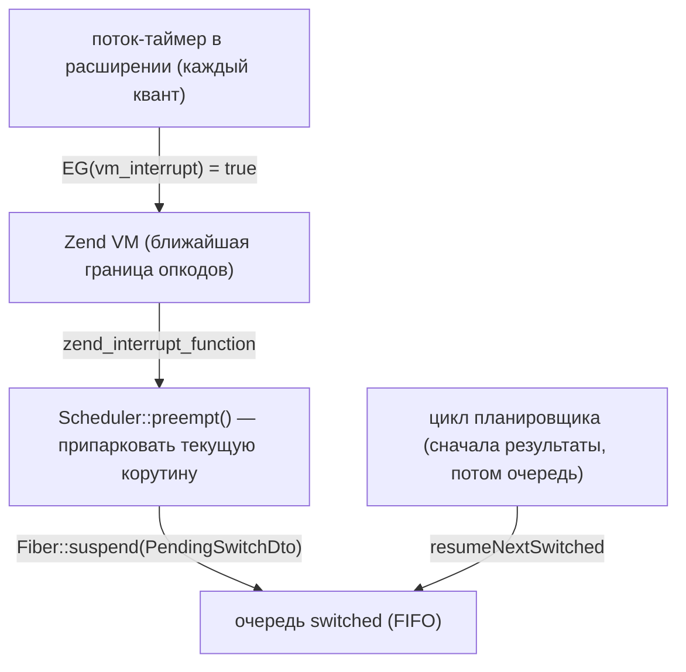

[English](coroutine-switching.md) | Русский

# Переключение корутин: `Scheduler::switch()` и автоматическая преемпция

PHP-поток один, и корутины переключаются кооперативно — обычно на вызовах фич,
где файбер приостанавливается, пока расширение делает I/O. У CPU-bound кода таких точек
нет: обработчик, занятый вычислениями, блокирует все остальные корутины
процесса, пока не закончит. Переключение закрывает это в двух видах:
`Scheduler::switch()` — явная точка переключения, которую вы ставите в свои
горячие циклы, — и автоматическая преемпция, когда расширение прерывает VM по
таймеру и делает то же самое за вас (по умолчанию выключена; долгоживущие воркеры
включают её одной опцией).

Переключение — инструмент для задержки, а не для пропускной способности. Общий объём
работы CPU не меняется, и PHP-поток остаётся один: тяжёлый обработчик всё равно
съест свои миллисекунды. Меняется то, кто его ждёт: без переключения один
CPU-bound запрос замораживает на всё своё время все остальные запросы, которые
обслуживает процесс; с переключением их задержка ограничена квантом. Пропускную
способность на CPU-нагрузке по-прежнему даёт пул процессов по одному на ядро,
поэтому [вердикт позиционирования](positioning.ru.md#нужен-ли-вам-sconcur)
остаётся в силе.

## `Scheduler::switch()` — явная точка переключения

```php
use SConcur\Scheduler\Scheduler;

$scheduler = Scheduler::get();

foreach ($rows as $row) {
    $scheduler->switch();

    heavyTransform($row);
}
```

`switch(int $quantumMs = 5): bool` паркует текущую корутину и даёт продвинуться
всему, что готово (доставленные результаты возобновляют свои корутины, серверный
цикл продолжает принимать запросы), затем возобновляет её и возвращает `true`.

Вызов рассчитан на горячий цикл, поэтому почти каждое обращение — дешёвый пустой
вызов (`false`) ценой одного сравнения `hrtime()`: вне файбера (синхронный путь), из
файбера, который планировщик не отслеживает, и пока не истёк квант. Первый вызов
только запускает квант; последующий уступает, когда корутина отработала
`$quantumMs` с момента последнего возобновления, а время в очереди в следующий
квант не засчитывается, поэтому одинаковые CPU-циклы делят поток поровну.
`quantumMs <= 0` заставляет уступать на каждом вызове (явные точки переключения,
тесты).

Механика: корутина приостанавливается с маркером `PendingSwitchDto`, а
планировщик добавляет её в FIFO-очередь припаркованных — тех, кто ждёт не
результата, а очереди на поток. Готовые результаты всегда в приоритете:
припаркованная корутина возобновляется, только когда доставлять больше нечего.
Поэтому два CPU-цикла выполняются по очереди, а завершения I/O никогда
не задерживаются из-за припаркованных вычислительных корутин.

## Автоматическая преемпция

Долгоживущие воркеры — три сервера (`HttpServer`, `SocketServer`, `WsServer`) и
[консьюмер очередей AMQP](amqp.ru.md#супервизируемый-консьюмер) — могут на время работы
включить автоматическую преемпцию, и тогда даже код, который никогда не вызывает
`switch()`, включая сторонние библиотеки, не может заморозить процесс. По умолчанию она
выключена: с ней между любыми двумя выражениями обработчика может выполниться сосед, а
часть состояния PHP, которое обработчик читает как своё, общая на весь процесс — см.
[состояние процесса](#состояние-процесса). Как это устроено:

1. На старте расширение подцепляет точку входа прерываний движка
   (`zend_interrupt_function`) и первым вызывает прежний обработчик, поэтому
   pcntl-сигнал обрабатывается до того, как корутина паркуется, а не после её
   возобновления.
2. Работающий воркер взводит таймер на стороне расширения; каждый квант таймер
   атомарно запрашивает прерывание VM (`EG(vm_interrupt)`), а движок замечает флаг
   на ближайшей границе опкодов — вызовы функций, обратные дуги циклов и те же
   проверки, которые opcache JIT вставляет в скомпилированные циклы.
3. Обработчик расширения, вызванный в PHP-потоке, вызывает `Scheduler::preempt()`,
   который принудительно паркует текущую корутину — ровно как `switch()` с
   истёкшим квантом. Состояния, перечисленные в разделе
   [Предохранители](#предохранители), он пропускает. По окончании работы таймер
   снимается.
4. Пока PHP-поток стоит внутри блокирующего вызова ожидания (простаивающий
   сервер ждёт следующий запрос), таймер ставится на паузу: PHP-код не
   исполняется, и прерывание всё равно не могло бы быть обслужено. Он
   возобновляется, как только ожидание возвращается, поэтому простаивающий воркер
   не платит за пробуждения таймера.



Настройка — опция `preemptionQuantumMs` (по умолчанию `0` — преемпция выключена), она есть у
всех четырёх и переопределяется как любая другая опция запуска:

```php
$server = new HttpServer(
    serverRequestFactory: $requestFactory,
    responseFactory: $responseFactory,
    preemptionQuantumMs: 5,
);
```

```console
php server.php --preemptionQuantumMs=5   # включить преемпцию для этого воркера
```

CLI-скрипты и использование библиотеки вне этих воркеров таймер не взводят, поэтому там
`Scheduler::switch()` — единственная точка переключения, если только не взвести тот
же таймер вручную:

```php
Scheduler::get()->enablePreemption();   // квант по умолчанию 5 мс

try {
    // CPU-bound корутины здесь вытесняемы даже без вызовов switch()
} finally {
    Scheduler::get()->disablePreemption();
}
```

`enablePreemption(int $quantumMs = 5)` регистрирует `Scheduler::preempt()` в
таймере прерываний расширения — та же обвязка, что у серверов, с теми же
предохранителями. Повторное включение заменяет прежний таймер. Всегда выключайте в
`finally`: таймер продолжает срабатывать до `disablePreemption()` или завершения
процесса.

Преемпция же позволяет [таймауту корутины](coroutine-timeout.ru.md) достать до
кода, который никогда не приостанавливается: срок доставляет тот же
`Scheduler::preempt()`, так что без взведённого таймера CPU-bound корутина
разматывается только на ближайшем ожидании.

## Цена под нагрузкой

Преемпция пропускает дешёвые запросы вперёд, и платят за это тяжёлые: время
самого CPU-обработчика растёт примерно во столько раз, сколько таких же
обработчиков воркер обслуживает одновременно. В одном потоке это арифметика, а
не настройка.

Замер на 8 воркерах и 256 соединениях, где 90% запросов идут на пустой эндпоинт,
а 10% — на обработчик ценой ~43 мс CPU:

| `preemptionQuantumMs` | p50 | p90 | p99 |
| ---: | ---: | ---: | ---: |
| 5 | 16.7 мс | 1.94 с | 2.75 с |
| 20 | 40.3 мс | 1.94 с | 2.95 с |
| 50 | 81.1 мс | 2.00 с | 3.79 с |
| 100 | 86.3 мс | 3.22 с | 6.46 с |
| 0 (выключена, по умолчанию) | 215.5 мс | 367.5 мс | 571.3 мс |

Хвост не двигается ничем, кроме полного выключения: с любым квантом корутины
чередуются и растягиваются все разом, без него выполняются до конца по очереди.
Промежуточный квант только ухудшает p50, а p99 делает ещё хуже, поэтому, включив
преемпцию, брать что-то кроме 5 мс обычно незачем.

Вторая настройка — `maxConcurrency` HTTP-сервера: она ограничивает не квант, а
число одновременно обслуживаемых обработчиков, то есть сколько их делит поток.
Замер с квантом 5 мс:

| `maxConcurrency` | p50 | p90 | p99 |
| ---: | ---: | ---: | ---: |
| 0 (без предела) | 16.7 мс | 1.94 с | 2.75 с |
| 16 | 154.6 мс | 983.0 мс | 1.73 с |
| 8 | 254.9 мс | 572.3 мс | 1.08 с |
| 4 | 266.4 мс | 481.1 мс | 620.4 мс |

Обе настройки двигают систему вдоль одной кривой: низкий p50 для дешёвых
запросов и короткий хвост для тяжёлых одновременно недостижимы. Выбирайте конец
под свою нагрузку. Значения по умолчанию стоят на дальнем конце первой таблицы: тяжёлые
обработчики выполняются до конца по очереди, а дешёвые запросы ждут за ними.

Саму кривую, а не точку на ней, сдвигают две вещи: больше процессов в пуле и
вынос тяжёлых вычислений из обработчика.

## Предохранители

Обработчик прерывания отказывается парковать корутину в состояниях, где
невидимое переключение сломало бы учёт движка или планировщика:

- там, где движок запрещает переключать файбер (`zend_fiber_switch_blocked()`), в том
  числе в обработчике pcntl-сигнала, — парковка там бросила бы исключение из
  обработчика до его конца, и обработчик SIGTERM, оборванный так, теряет остановку;
- пока идёт автозагрузка (`EG(in_autoload)` не пуст) — парковка там привела бы к
  «class not found» у всех остальных корутин, запросивших тот же класс;
- пока обрабатывается исключение (`EG(exception)`) или сработал таймаут
  выполнения;
- внутри перехода к suspend — между объявлением приостановки (регистрацией
  ожидающего вложенную группу, передачей задачи планировщику) и самим
  `Fiber::suspend`, где парковка рассинхронизировала бы маршрутизацию результатов;
- вне отслеживаемых корутин: цикл планировщика и синхронный код не прерываются
  никогда.

## О чём стоит помнить

При включённой преемпции точки переключения становятся невидимыми: код, который
рассчитывал, что между двумя выражениями ничего не выполняется (неатомарное
чтение-изменение-запись статического свойства или общего массива), теперь может
перемежаться с другими обработчиками — ровно как это уже могло происходить на любом вызове фичи.
Обработчикам, которым такие участки нужны атомарными, стоит не делать внутри них
вызовов фич и `switch()` либо запускать воркер с `preemptionQuantumMs: 0`.

Одиночные монолитные внутренние вызовы остаются невытесняемыми в любом случае —
`preg_match` по огромной строке, `json_decode` огромного документа, — потому что
исполняются между границами опкодов. Квант ограничивает задержку между опкодами, а
не внутри одного внутреннего вызова.

### Состояние процесса

То же касается состояния, которое PHP хранит на процесс, а не на корутину. Функция,
которая сообщает результат предыдущего вызова через такое состояние, работает
правильно, только если между двумя вызовами ничего не выполнилось:

```php
$data = json_decode($body);

if (json_last_error() !== JSON_ERROR_NONE) {   // может оказаться результатом соседа
    // ...
}
```

Движок проверяет отложенное прерывание сразу после возврата из внутренней
функции, а долгий вызов — как раз то место, где срабатывает таймер. Поэтому
преемпция между `json_decode()` и `json_last_error()` — ожидаемый случай, а не
редкий. Чем короче квант, тем он вероятнее. Одиночную корутину с включённой
преемпцией это не задевает: сам планировщик это состояние не трогает.

| Состояние | Что его читает | Безопасная форма |
| --- | --- | --- |
| ошибка JSON | `json_last_error()`, `json_last_error_msg()` | `JSON_THROW_ON_ERROR` |
| ошибка PCRE | `preg_last_error()`, `preg_last_error_msg()` | проверять результат вызова `preg_*` (`false`/`null` при ошибке) |
| последняя ошибка PHP | `error_get_last()`, `error_clear_last()` | проверять результат вызова; сообщению верить нельзя |
| ошибки разбора дат | `DateTime::getLastErrors()`, `date_get_last_errors()` | проверять `createFromFormat()` на `false` либо создавать через конструктор и ловить `DateMalformedStringException` |
| ошибки libxml | `libxml_get_errors()`, `libxml_get_last_error()`, `libxml_use_internal_errors()` | нет |
| очередь ошибок OpenSSL | `openssl_error_string()` | нет |
| буферы вывода | `ob_start()` … `ob_get_clean()` | нет |
| обработчики ошибок и исключений | `set_error_handler()`/`restore_error_handler()`, `set_exception_handler()`/`restore_exception_handler()` | нет |

Больше всего вреда от двух последних. Буферы вывода — один стек на процесс: `echo`
соседа попадает в тот буфер, который сейчас сверху, поэтому в шаблон, собираемый
через `ob_start()` (обычные PHP-шаблоны, Blade, Twig), может попасть вывод другого
запроса. Обработчики — тоже один стек: предупреждение соседа уходит в чужой
обработчик, а две перемежающиеся пары `set`/`restore` снимают обработчики друг друга.

Оператор `@` в том же замере не протёк: сосед, выполнявшийся, пока корутина стояла
внутри `@call()`, видел свой `error_reporting()`.

Ничего нового здесь нет: то же перемежение уже происходит на любом вызове фичи.
Преемпция делает точки переключения невидимыми, и под удар попадает код, который
между двумя строками фичи не вызывает, — в том числе сторонние библиотеки. Поэтому
по умолчанию преемпция выключена. Включайте её для воркера, чьи обработчики и их
библиотеки не опираются на состояние из таблицы.

## См. также

- [HTTP-сервер](http-server.ru.md), [Сокет-сервер](socket-server.ru.md),
  [WebSocket-сервер](websocket-server.ru.md),
  [AMQP](amqp.ru.md#супервизируемый-консьюмер) — воркеры, включающие преемпцию.
- [Архитектура](architecture.ru.md) — планировщик, файберы и флоу.
- [Позиционирование](positioning.ru.md#нужен-ли-вам-sconcur) — вердикт по
  CPU-bound, который эта фича смягчает (латентность, а не пропускная
  способность).
