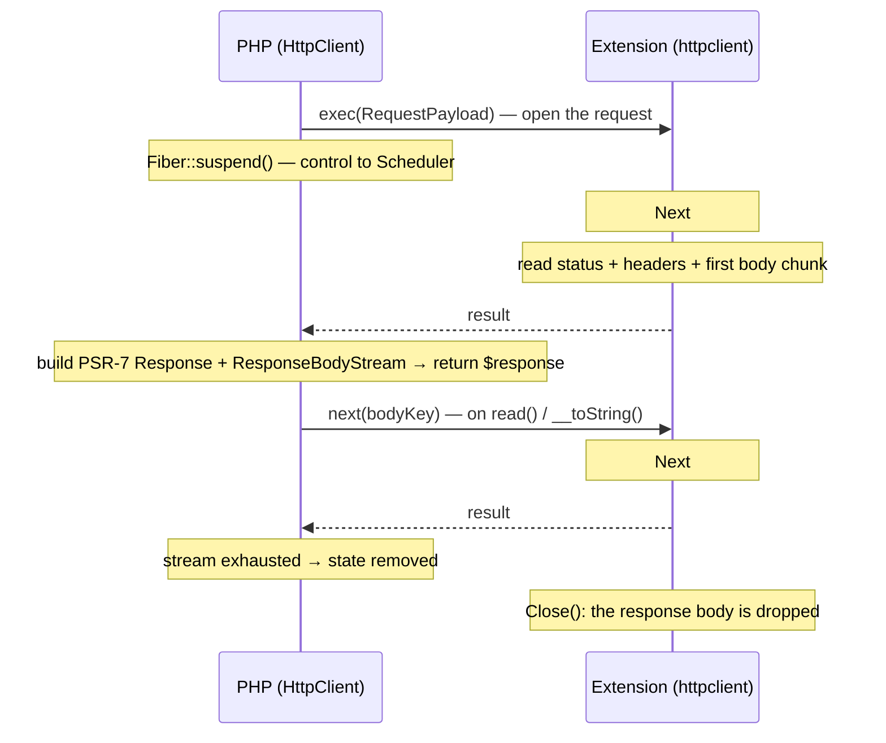

English | [Русский](http-client.ru.md)

# HTTP client (PSR-18) with streaming

An asynchronous PSR-18 HTTP client. All network I/O (DNS, connection, TLS, sending the
request, reading the response) lives in the extension on top of `reqwest`: the request
goes into a runtime task, the calling coroutine (a PHP fiber the scheduler suspends
while the extension works) waits, and dozens of requests can be in progress at once.
Outside a `WaitGroup` the same API works synchronously.

The response body is a PSR-7 `StreamInterface` (`ResponseBodyStream`) that lazily
pulls chunks from the extension, like a Mongo cursor, so a response is never
buffered whole.

## Quick start

```php
use Nyholm\Psr7\Factory\Psr17Factory;
use SConcur\Features\HttpClient\HttpClient;

$factory = new Psr17Factory();              // any PSR-17 implementation
$client  = new HttpClient($factory);

$response = $client->sendRequest($factory->createRequest('GET', 'https://example.com/'));

$status = $response->getStatusCode();        // int
$body   = (string) $response->getBody();     // reads the stream to the end
```

`ResponseFactoryInterface` (PSR-17) is a mandatory constructor argument — the library
is not tied to a specific PSR-7 implementation. In `require` there are only the
interfaces (`psr/http-client`, `psr/http-message`, `psr/http-factory`); the tests
use `nyholm/psr7`.

## Model

A request is a streaming state: the first result carries the response metadata
(status, headers, first body chunk, `Content-Length`), the following ones are raw
body chunks, which `ResponseBodyStream` pulls on demand.



An unfinished response is closed with its flow (the group of tasks a `WaitGroup`
owns inside the extension): outside a coroutine `close()`, `detach()` or destroying
the stream does it at once; inside a `WaitGroup` it happens when the group finishes.

## Running requests concurrently

```php
use SConcur\WaitGroup;

$waitGroup = WaitGroup::create();

foreach ($urls as $url) {
    $waitGroup->add(fn () => $client->sendRequest($factory->createRequest('GET', $url)));
}

/** @var array<int|string, \Psr\Http\Message\ResponseInterface> $responses */
$responses = $waitGroup->waitResults();      // total time ≈ the slowest request
```

PSR-18 is synchronous by contract; inside a coroutine `sendRequest()` still returns
a ready `ResponseInterface`, built while other coroutines run.

## Response streaming

`Dto/ResponseBodyStream` is a PSR-7 `StreamInterface`: one-directional, read-only,
not seekable (`seek`/`rewind`/`write` throw, which PSR-7 allows for non-rewindable
streams). `read($length)` returns up to `$length` bytes — first the inline chunk of
the first result, then the rest via `next($bodyKey)`, which suspends the coroutine
so a slow server does not block other requests. `getSize()` is `Content-Length` if
known (not chunked), otherwise `null`; `close()`/`detach()`/`__destruct()` release
it early only outside a coroutine (see Model).

```php
$response = $client->sendRequest($factory->createRequest('GET', $url));

$stream = $response->getBody();

while (!$stream->eof()) {
    $chunk = $stream->read(64 * 1024);       // inside a coroutine it suspends it
    // ...process the chunk...
}
```

The transport granularity is the `chunkSize` option (default 64 KiB): a body up to
that size arrives inline with the first result without extra round-trips, a larger
one comes in pieces per round-trip.

> Read the body inside the `WaitGroup` that sent the request: when `waitResults()`
> returns, the group's flow ends and an unread body is closed. A response no larger
> than `chunkSize` arrives whole with the first result and stays readable afterwards.

## Request body

By default the request body is read whole and goes into the payload. For large
bodies enable `streamRequestBody: true`: the body is sent in `chunkSize` pieces
PHP → the extension and written into the outgoing body; the transport dictates the
pace of the writes, and the body is never buffered whole.

```php
$client = new HttpClient($factory, new HttpClientOptions(streamRequestBody: true));

$response = $client->sendRequest(
    $factory->createRequest('POST', $url)->withBody($largeStream)
);
```

> With `streamRequestBody: true` redirects are not followed — a streamed body is
> read once and cannot be replayed on a 3xx, so the redirect response is returned
> as-is. For requests with redirects use the buffered mode.

## Options and timeouts

`SConcur\Features\HttpClient\HttpClientOptions` (`readonly`), all timeouts in ms.

| Option | Default | Purpose |
|---|---|---|
| `requestTimeoutMs` | `30000` | Full request deadline (connect + send + reading the whole body), a hard limit enforced inside the extension. `0` — off (not recommended). |
| `connectTimeoutMs` | `10000` | Connection establishment limit, TLS handshake included. |
| `responseHeaderTimeoutMs` | `15000` | Limit waiting for status + headers. Not applied with `streamRequestBody: true` or in `download()`. |
| `maxResponseBody` | `0` (unlimited) | Response body cap in bytes. Crossing it fails the read that crosses it: `sendRequest()` throws `NetworkException` if that is the first chunk, a later `read()` throws otherwise. `download()` does not apply it. With `0`, watch for OOM. |
| `followRedirects` | `true` | Whether to follow 3xx redirects. |
| `maxRedirects` | `10` | Redirect hop limit. |
| `chunkSize` | `65536` | Granularity of reading the response body and sending the request body. |
| `verifyTls` | `true` | Whether to verify TLS certificates. |
| `maxIdleConns` | `100` | Accepted and not applied: the pool is sized per host, so a process-wide total has nothing to set. `maxIdleConnsPerHost` is what takes effect. |
| `maxIdleConnsPerHost` | `16` | Idle keep-alive connections per host. |
| `idleConnTimeoutMs` | `90000` | How long an idle keep-alive connection is kept. |
| `tlsHandshakeTimeoutMs` | `10000` | Accepted and not applied: there is no separate handshake limit, `connectTimeoutMs` bounds the handshake with the connection. |
| `streamRequestBody` | `false` | Stream the request body in chunks instead of buffering it whole. |
| `throwOnToStringError` | `true` | Whether `ResponseBodyStream::__toString()` may throw on a read error. PSR-7 forbids throwing from `__toString`; when `false` the error becomes an `E_USER_WARNING` and an empty string. |

```php
$client = new HttpClient($factory, new HttpClientOptions(
    requestTimeoutMs: 5_000,
    maxResponseBody: 8 * 1024 * 1024,        // 8 MiB, OOM protection
    followRedirects: false,
    verifyTls: false,                        // only for self-signed in dev
));
```

Connection pool / keep-alive: the extension keeps reusable `reqwest::Client`s, one
per distinct set of transport options (redirects, `connectTimeoutMs`, `verifyTls`
and the pool parameters), so keep-alive works between requests within the
process. Releasing the extension drops the clients and with them the idle
connections.

## Downloading to a file

`download()` writes the response body straight into a file inside the extension —
the bytes never cross into PHP. The body is consumed as a stream of chunks and
each is written as it arrives, so memory is constant for any size, there are no
per-chunk round-trips, and inside a `WaitGroup` several downloads run at the same
time.

```php
use SConcur\Features\HttpClient\DownloadFileMode;

$result = $httpClient->download(
    request: $factory->createRequest('GET', 'https://example.com/big.iso'),
    path: '/var/data/big.iso',
    mode: DownloadFileMode::Replace,   // default
    bufferSizeBytes: 1 << 20,          // opt., ignored: the transport sizes the buffers
    perm: 0644,                        // opt., create permissions
);

$result->statusCode;          // always 2xx (otherwise an exception)
$result->headers;             // response headers as the server returned them
$result->filesizeBytes;       // exact bytes written, counted as they are written
$result->executionMs;         // download time
```

Modes: `Replace` — create or truncate; `Create` — create, error if the file
exists; `Append` — create or append.

Only a 2xx is written; the status is checked before the file is opened, so a
non-2xx leaves it untouched. A non-2xx, transport or file error throws
`SConcur\Exceptions\HttpClient\DownloadException` (`getStatusCode()` is the status
for a non-2xx and `null` otherwise; the cause is in `getPrevious()`). A transfer
that breaks off removes the partial file for `Replace`/`Create` and keeps it for
`Append`, since an append cannot be rolled back. `filesizeBytes` does not depend
on `Content-Length`. The whole download is bounded by `requestTimeoutMs` — raise it
for large files; a stopped `WaitGroup` does not interrupt it, only that deadline
does. `streamRequestBody` does not apply (the request body is buffered).

## Error handling (PSR-18)

`4xx`/`5xx` are not client errors — they are a normal `ResponseInterface`.
Exceptions are thrown only on a send or connection failure:

| Case | SConcur exception | PSR-18 interface |
|---|---|---|
| Network unreachable (refused, DNS-fail, timeout, dropped, redirect limit) | `Exceptions\HttpClient\NetworkException` | `NetworkExceptionInterface` |
| Malformed request (invalid method, not sent) | `Exceptions\HttpClient\RequestException` | `RequestExceptionInterface` |
| Other client error | `Exceptions\HttpClient\HttpClientException` | `ClientExceptionInterface` |

`NetworkException`/`RequestException` carry `getRequest(): RequestInterface`. The
extension side marks the error class with a prefix (`net: `/`req: `) in the payload, and
PHP maps it across the whole `getPrevious()` chain to the right class.

```php
try {
    $response = $client->sendRequest($request);
} catch (NetworkExceptionInterface $exception) {
    $failedRequest = $exception->getRequest();  // retry / logging
}
```

## Internals

PHP (`src/Features/HttpClient/`): `HttpClient` assembles the `RequestPayload`,
sends it via `FeatureExecutor::exec()`, decodes the first result's metadata, builds
the response and attaches `ResponseBodyStream`; `download()` lives here too.
Alongside it: `HttpClientOptions`, `DownloadFileMode`, `HttpClientCommandEnum` (the
envelope's sub-operations `Request`/`UploadChunk`/`UploadEnd`), `Payloads/*`
(mirrors of the extension's structs), `Dto/ResponseBodyStream` and `Dto/DownloadResult`.

Rust (`ext/src/features/httpclient/`): `mod.rs` builds the request, applies the
request deadline, starts the state and routes the commands; `response_state.rs`
is the streaming state (the first step runs the request and returns metadata plus
the first chunk, the rest are raw body chunks, closing it drops the response body
stream) and also holds the `maxResponseBody` limit; `client.rs` is the registry
of reusable `reqwest::Client`s; the `download` and `upload` command handlers are
the file sink and the request-body pipe.

## Limitations

HTTP/2 is negotiated over TLS when the server offers it; over plain HTTP the
connection is HTTP/1.1 and there is no prior-knowledge h2c. The protocol version
is not surfaced to PHP.

Not supported: a cookie jar (do it application-side or in PSR-7 middleware), a
proxy set in code (the `HTTP_PROXY`/`HTTPS_PROXY`/`ALL_PROXY`/`NO_PROXY`
environment variables are honoured), a custom CA bundle, and PSR-18 async
(`sendAsyncRequest`) — concurrency goes through `WaitGroup`, not promises.

## Testing

PHP feature tests are in `tests/feature/Features/HttpClient/` — edge cases,
download to a file and the concurrency contract on `BaseAsyncTestCase`, with
requests targeting the real SConcur HTTP server started via `TestHttpServer`.
The core's own tests (`ext/src/features/httpclient/payloads.rs`) pin the maps PHP
reads for the first result and for a download. The benchmark
(`make bench-http-client c=20`) sends N requests to `/msleep`, concurrent async
against sequential native/sync.

Run: `make test c="--filter=HttpClient"`, `make ext-test`.
