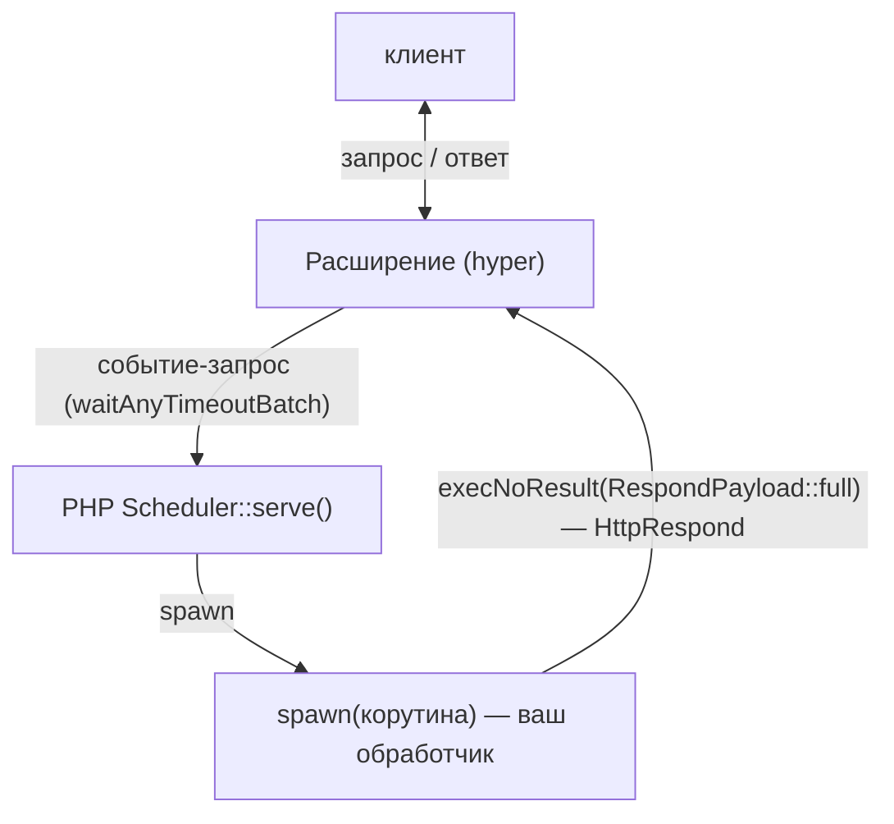
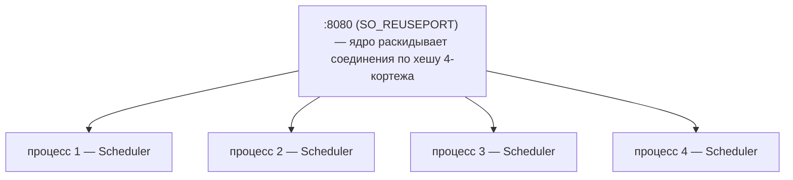

[English](http-server.md) | Русский

# HTTP-сервер

Долгоживущий PHP-демон, который принимает HTTP-запросы и обрабатывает каждый в
отдельной корутине (Fiber), конкурентно с остальными. Сетевой I/O живёт в
расширении; PHP остаётся тонким слоем-оркестратором. Реализация:
`src/Features/HttpServer/` (PHP) и `ext/src/features/httpserver/` (Rust).

> ⚠️ Сначала прочитайте [«Чего нет в отличие от типовых
> серверов»](#чего-нет-в-отличие-от-типовых-серверов) — модель кооперативная и
> однопоточная, это ограничивает код обработчиков.

## Оглавление

- [Модель](#модель)
- [Быстрый старт](#быстрый-старт)
- [Параметры сервера](#параметры-сервера)
- [Запрос и ответ (PSR-7)](#запрос-и-ответ-psr-7)
- [Стриминг ответа (chunked / SSE)](#стриминг-ответа-chunked--sse)
- [Файлы](#файлы)
- [Обработка ошибок](#обработка-ошибок)
- [Логи](#логи)
- [Конкурентность и лимиты](#конкурентность-и-лимиты)
- [Масштабирование на ядра (SO_REUSEPORT)](#масштабирование-на-ядра-so_reuseport)
  - [Второй процесс на том же порту](#второй-процесс-на-том-же-порту)
  - [Прокси перед пулом](#прокси-перед-пулом)
- [OPcache и JIT](#opcache-и-jit)
- [Остановка после N запросов](#остановка-после-n-запросов)
- [Мягкая остановка](#мягкая-остановка)
- [Внутреннее устройство](#внутреннее-устройство)
- [Чего нет в отличие от типовых серверов](#чего-нет-в-отличие-от-типовых-серверов)
- [Запуск в Docker и тестирование](#запуск-в-docker-и-тестирование)

## Модель

Сетевой стек (приём соединений, парсинг HTTP, keep-alive, таймаут обработчика,
запись ответа) работает внутри расширения, на hyper. Каждый принятый запрос
превращается в обычный результат и приходит в PHP через тот же общий канал
результатов, что и все прочие задачи, поэтому сервер переиспользует существующий
`Scheduler` и не вводит второй event-loop.

Базовая модель — spawn-на-запрос: на каждое событие-запрос создаётся новая
корутина-обработчик, а обычные асинхронные вызовы SConcur внутри неё выполняются
конкурентно с обработкой других запросов.

Воркер — долгоживущий процесс: всё, что создано до `serve()` (загрузка
фреймворка, DI-контейнер, конфиг, соединения), переиспользуется каждым запросом.
Состояние переживает запросы, поэтому данные отдельного
запроса держите в [контексте корутины](coroutine-context.ru.md) или локально в
обработчике, а процесс периодически перезапускайте через `maxRequests`.



Контракт обработчика — PSR-7: на вход `ServerRequestInterface`, на выход
`ResponseInterface`. Библиотека не зависит ни от какой конкретной PSR-7
реализации — объекты создаёт PSR-17 фабрика, переданная в конструктор; это
зеркало [HTTP-клиента (PSR-18)](http-client.ru.md).

## Быстрый старт

```php
use Nyholm\Psr7\Factory\Psr17Factory;
use Psr\Http\Message\ResponseInterface;
use Psr\Http\Message\ServerRequestInterface;
use SConcur\Features\HttpServer\HttpServer;

require __DIR__ . '/vendor/autoload.php';

$factory = new Psr17Factory(); // одна фабрика играет обе нужные роли PSR-17

$server = new HttpServer(
    serverRequestFactory: $factory,
    responseFactory:      $factory,
    address:              '0.0.0.0:8080',
);

$server->serve(static function (ServerRequestInterface $request) use ($factory): ResponseInterface {
    return match ($request->getUri()->getPath()) {
        '/'      => $factory->createResponse(200)->withBody($factory->createStream('ok')),
        '/ping'  => $factory->createResponse(200)->withBody($factory->createStream('pong')),
        default  => $factory->createResponse(404)->withBody($factory->createStream('not found')),
    };
});
```

Подойдёт любая PSR-7/PSR-17 реализация (`nyholm/psr7`, `guzzlehttp/psr7`,
`laminas/laminas-diactoros`, …). Конструктору нужны `ServerRequestFactoryInterface`
(создать запрос) и `ResponseFactoryInterface` (запасные ответы `413`/`500`);
`Psr17Factory` реализует обе.

```shell
php -d extension=./ext/build/sconcur.so server.php
```

`serve()` блокируется до `SIGTERM`/`SIGINT` или до остановки его флоу (группы
задач, в которой работает сервер). Обработчик исполняется в своей корутине, поэтому
асинхронные фичи внутри него (`Sleeper::usleep()`, MongoDB, SQL, HTTP-клиент) не
блокируют другие запросы.

## Параметры сервера

Конструктор `HttpServer` (`src/Features/HttpServer/HttpServer.php`). Все таймауты
в миллисекундах.

| Параметр | По умолчанию | Назначение |
|---|---|---|
| `serverRequestFactory` | — (обязателен) | PSR-17 `ServerRequestFactoryInterface` — из неё строится запрос обработчика. |
| `responseFactory` | — (обязателен) | PSR-17 `ResponseFactoryInterface` — запасные ответы `413`/`500`. |
| `address` | `0.0.0.0:7832` | Адрес прослушивания, например `0.0.0.0:8080`. Связывается с `SO_REUSEPORT`, см. [масштабирование на ядра](#масштабирование-на-ядра-so_reuseport). |
| `readHeaderTimeoutMs` | `10000` | Принимается и не применяется — см. [Таймауты соединения](#таймауты-соединения). |
| `readTimeoutMs` | `30000` | Принимается и не применяется. |
| `writeTimeoutMs` | `30000` | Принимается и не применяется. |
| `idleTimeoutMs` | `60000` | Принимается и не применяется. |
| `shutdownTimeoutMs` | `10000` | Сколько останавливающийся сервер ждёт, пока его соединения допишут последние ответы и закроются, см. [мягкую остановку](#мягкая-остановка). `0` — сколько понадобится. |
| `maxRequestBody` | `10485760` (10 MiB) | Лимит тела запроса; превышение → `413`. |
| `maxConcurrency` | `0` (без лимита) | Одновременно обрабатываемых запросов, см. [лимиты](#конкурентность-и-лимиты). |
| `handlerTimeoutMs` | `60000` | Полное время обработки запроса, включая стрим, иначе `504`/обрыв. `0` — PHP-обработчик не прерывается; расширение всё равно отвечает `504` через 60 с. |
| `maxRequests` | `0` (без лимита) | Остановить сервер после N запросов, см. [ниже](#остановка-после-n-запросов). |
| `onError` | `null` | `Closure(Throwable, ServerRequestInterface): ?ResponseInterface`. |
| `masterPid` | `null` | Штатно остановиться, как только этот pid перестал быть родителем. `null` — мастер, форкнувший этот воркер (`WorkerContext`, см. [мастер воркеров](worker-master.ru.md#самозавершение-осиротевших-воркеров)), а вне мастера проверки нет. |
| `telemetrySocket` | `null` | Unix-сокет для снапшотов статистики ([статистика](admin-stats.ru.md)); `''` — выкл. `null` — `SCONCUR_TELEMETRY_SOCKET` из окружения, который мастер ставит своим воркерам. |
| `serverName` | `null` | Имя воркера в снапшотах статистики. `null` — `SCONCUR_SERVER_NAME` из окружения, который мастер ставит как `<группа>:<слот>`, или `sconcur-server`. |
| `telemetryIntervalMs` | `null` | Период снапшотов; `0` — значение по умолчанию у отправителя (1000 мс). `null` — `SCONCUR_TELEMETRY_INTERVAL_MS` из окружения или это значение. |
| `preemptionQuantumMs` | `0` | Квант автоматической преемпции во время serve; `0` — выкл. Перед включением прочитайте про [состояние процесса](coroutine-switching.ru.md#состояние-процесса). |

### Сборка сервера из argv

`HttpServer::fromArgs()` собирает сервер из `argv`: каждый `--имя=значение`
сопоставляется с одноимённым скалярным параметром конструктора (с проверкой
типа), неизвестный флаг → исключение. PSR-17 фабрики через argv не передать,
поэтому они остаются аргументами. Это для скрипта, который запускает один сервер сам
по себе, — роль [мастера воркеров](worker-master.ru.md) строит сервер конструктором:

```php
$server = HttpServer::fromArgs(
    argv:                 $_SERVER['argv'],
    serverRequestFactory: $factory,
    responseFactory:      $factory,
);
```

### Таймауты соединения

Четыре дедлайна соединения пересекают границу, но ни на что не влияют: расширение
ограничивает запрос по `handlerTimeoutMs` и больше ничем. Медленный клиент поэтому держит
своё соединение сколько хочет, пока сервер работает. Останавливающийся сервер ждёт свои
соединения не дольше `shutdownTimeoutMs` (см. [мягкую остановку](#мягкая-остановка)) и
выходит; обработчик, который к этому моменту ещё работает, раскручивается. Медленных
клиентов обрывайте на обратном прокси впереди.

## Запрос и ответ (PSR-7)

Обработчик получает `ServerRequestInterface`, собранный из события вашей
фабрикой:

| Что нужно | Метод PSR-7 |
|---|---|
| Метод | `$request->getMethod()` |
| Путь | `$request->getUri()->getPath()` — уже декодирован расширением (`%2F` приходит как `/`), без query |
| Сырая query-строка | `$request->getUri()->getQuery()` |
| Распарсенный query | `$request->getQueryParams()` — заполняется через `parse_str()` |
| Все заголовки | `$request->getHeaders()` — `array<string, array<int, string>>` |
| Один заголовок | `$request->getHeaderLine('X-Echo')` / `getHeader()` |
| Версия протокола | `$request->getProtocolVersion()` — `"1.1"`, без префикса `HTTP/` |
| Адрес клиента и пр. | `$request->getServerParams()` — `REMOTE_ADDR`, `REMOTE_PORT`, `REQUEST_METHOD`, `REQUEST_URI`, `QUERY_STRING`, `SERVER_PROTOCOL`, `HTTP_HOST` |
| Тело | `$request->getBody()` — `StreamInterface`, см. ниже |

Куки, разобранное тело и загруженные файлы (`getCookieParams()`,
`getParsedBody()`, `getUploadedFiles()`) не заполняются — по конвенции PSR-7 это
работа вашего middleware.

### Запрос ленив к заголовкам

Обработчику передаётся `Dto/LazyHeadersRequest` — `ServerRequestInterface`,
обёрнутый вокруг того объекта, который построила ваша фабрика. Заголовки и
query-строка держатся в стороне и применяются при первом обращении: установка
семи заголовков стоит 4.17 мкс из 7.75, которые занимает весь декод, разбор
query — ещё 1.9, а роутер читает метод и путь, то есть 0.12 (`make bench-request`).
Лень переживает `withAttribute` и остальные withers, так что запись параметров
маршрута её не срывает.

На поверхности PSR-7 не меняется ничего: каждый метод отвечает то же, что ответил
бы жадно построенный запрос, и `getHeaders()` возвращает тот же массив в том же
порядке. Меняются две вещи, и только для кода, который смотрит мимо интерфейса:

- `instanceof Nyholm\Psr7\ServerRequest` (или любой другой конкретный класс)
  теперь ложь — конкретный объект лежит уровнем внутрь. Типизируйтесь на
  `ServerRequestInterface`, как и предполагает PSR-7;
- `$request->materialize()` возвращает обычный запрос со всем применённым — для
  редкого случая, когда конкретный объект нужно отдать наружу.

Обработчик, который читает хотя бы один заголовок, платит на 0.36 мкс больше, чем с
заголовками, применёнными сразу. Это и есть размен: лень оправдана, пока заголовки
читаются менее чем в 91% запросов.

Тело — `Dto/RequestBodyStream` поверх `Dto/RequestBody`. Расширение читает тело
целиком до запуска обработчика и передаёт его вместе с запросом, поэтому тело
лежит в памяти полностью, до `maxRequestBody`. Поток одноразовый и не
перематываемый (`isSeekable()` → `false`; `seek`/`rewind`/`write` бросают
исключение), поэтому читайте одним способом на запрос:

```php
// 1) Полностью (мелкие тела — JSON, форма). Мемоизируется.
$data = json_decode($request->getBody()->getContents(), true);

// 2) Кусками (тело уже в памяти; так лишь не делается вторая копия):
$body = $request->getBody();
while (($chunk = $body->read(8192)) !== '') { // '' по концу потока (PSR-7)
    hash_update($hash, $chunk);
}
```

- Пока тело ещё приходит, запрос до PHP не дошёл, поэтому медленный загрузчик
  не блокирует другие запросы.
- `read($length)` нарезает уже пришедшее тело и никогда не приостанавливает
  корутину.
- `getSize()` → `null`.
- Тело больше `maxRequestBody` до обработчика не доходит: расширение само
  отвечает `413 Payload Too Large` — сначала по заявленному `Content-Length`,
  затем по реально пришедшим байтам, потому что chunked-тело ничего не заявляет.

Обработчик возвращает любой `ResponseInterface`:

```php
return $factory->createResponse(200)
    ->withHeader('Content-Type', 'text/plain')            // строка или список строк
    ->withHeader('Set-Cookie', ['a=1; Path=/', 'b=2'])    // каждое значение — своя строка заголовка
    ->withBody($factory->createStream('hello'));
```

- Тело известного размера уходит одной записью; `getSize() === null` — это стрим,
  см. ниже.
- Без `Content-Type` непустое одноразовое тело уходит как
  `text/plain; charset=utf-8`; потоковый ответ не получает никакого.
- У ответов 204/304 тело отбрасывается.
- Возврат не-`ResponseInterface` — ошибка контракта
  (`InvalidHandlerResponseException`): клиент получает `500`, вызывается
  `onError`.

## Стриминг ответа (chunked / SSE)

Отдельного DTO для стрима нет — это закрыто самим PSR-7: верните ответ, тело
которого — ленивый `StreamInterface` неизвестного размера (`getSize()` → `null`).
Тогда фреймворк вычитывает его по чанкам (`read()`, по 64 KiB), отправляя каждый
клиенту и дожидаясь, пока соединение его примет (chunked transfer, SSE). Чтение идёт
в корутине запроса, поэтому ваш `read()` может приостанавливаться на асинхронных
фичах и лениво производить следующий чанк.

```php
use SConcur\Tests\Impl\HttpServer\GeneratorStream; // StreamInterface поверх Generator

$chunks = (static function (): Generator {
    foreach (range(1, 5) as $i) {
        yield "data: event $i\n\n"; // один yield — один отправленный клиенту чанк
        Sleeper::sleep(seconds: 1); // между чанками можно делать async-работу
    }
})();

return $factory->createResponse(200)
    ->withHeader('Content-Type', 'text/event-stream')
    ->withBody(new GeneratorStream($chunks));
```

- Темп задаёт клиент: чанк подтверждается только после того, как соединение его
  приняло, поэтому быстрый производитель данных не обгоняет медленного клиента.
- Без `Content-Length` — заголовок без длины, дальше chunked transfer encoding.
- Статус нельзя поменять после первого чанка (заголовки уже на проводе), поэтому
  исключение при чтении тела не превращается в `500` — оно только сообщается в
  `onError`, после чего поток корректно завершается.

## Файлы

Загрузку пишут на диск кусками из уже лежащего в памяти тела. У ответа-файла из
`createStreamFromFile()` размер известен, поэтому файл целиком читается в память и
уходит одной записью, а `Content-Length` выставляется сам. Файл, который не стоит
держать в памяти, отдавайте потоком неизвестного размера (см.
[стриминг](#стриминг-ответа-chunked--sse)).

```php
// Загрузка: пишем тело запроса в файл.
$handle = fopen($target, 'wb');
$body   = $request->getBody();

while (($chunk = $body->read(8192)) !== '') {
    fwrite($handle, $chunk);
}

fclose($handle);

// Отдача файла: тело — файловый поток, длина известна.
$stream = $factory->createStreamFromFile($path, 'rb');

return $factory->createResponse(200)
    ->withHeader('Content-Type', 'image/png')      // image/* → браузер покажет inline
    ->withHeader('Content-Disposition', 'inline')  // attachment; filename="..." — для скачивания
    ->withBody($stream);
```

Готовые маршруты есть в демо-сервере (`tests/servers/http/http-server.php`):
`POST /files/upload?name=`, `GET /files/download?name=`, `GET /image?name=`.

## Обработка ошибок

Исключение в обработчике или неверный тип возврата дают клиенту `500` — петля
`serve()` не падает. По умолчанию ошибка проглатывается; передайте `onError`,
чтобы увидеть её или вернуть свой ответ:

```php
onError: static function (\Throwable $e, ServerRequestInterface $request) use ($factory): ?ResponseInterface {
    error_log((string) $e);

    return $factory->createResponse(500)->withBody($factory->createStream('oops'));
}
```

`onError`, бросивший исключение сам, безопасно проглатывается — клиент всё равно
получит `500`.

## Логи

Access-лог — по строке на запрос в `STDOUT` (под мастером воркеров — туда, куда
указывает его [`accessLog`](worker-master.ru.md#access-строки)), включая ответы,
которые расширение даёт само (`504` по таймауту обработчика, `413` на превышение тела,
`503` запросу, пришедшему к серверу, чья остановка вышла за `shutdownTimeoutMs`). Запрос, клиент которого отключился до ответа, строки не
оставляет:

```
2026-06-14T17:36:26.123456 GET / 200 2.59ms
2026-06-14T17:36:26.456789 GET /msleep/30 200 34.77ms
```

Время — момент приёма запроса; последнее поле — время до передачи ответа соединению;
для стрима — до его заголовков, а не вся длительность. Строку формирует та же задача
рантайма, что пишет ответ, поэтому лог не стоит ни одного пересечения границы на
запрос (это самая дорогая часть обработки крошечного запроса — вынос лога на сторону
расширения почти удваивает пропускную способность одного ядра на hello-world). Вывод
асинхронный: фоновый поток пишет из буфера, сбрасывая его каждые ~100 мс; при
переполнении лишние строки отбрасываются со счётчиком. Метод и путь экранируются
(управляющие байты, в том числе `CR`/`LF` из URL-кодированного пути, выводятся как
`\xNN`), поэтому запрос не может подделать вторую строку лога.

Строки жизненного цикла пишет PHP-сторона и сразу сбрасывает — одна при старте, по
одной на шаг остановки:

```
2026-06-28T12:00:00.000000 sconcur http server listening on 0.0.0.0:8080 pid=12345 version=X.Y.Z maxConcurrency=0 maxRequests=0
2026-06-28T12:00:01.000000 sconcur http server shutdown: stop accepting (reason=signal), draining 2 in-flight
2026-06-28T12:00:01.050000 sconcur http server shutdown: drained all in-flight
2026-06-28T12:00:01.060000 sconcur http server shutdown: stopped
```

Затянувшаяся остановка раз в 5 с пишет, чего она ещё ждёт.
`reason=signal` — `SIGTERM`/`SIGINT` или потеря мастера; `reason=limit` —
достигнут `maxRequests`, в логе — `reason=limit, limit=N` с числом, на котором воркер
остановился. Под [мастером воркеров](worker-master.ru.md) `STDOUT`
воркера перехватывается и переписывается в общий лог; access-строки можно вместо этого
писать в файл дня, который каждый воркер пишет сам, — см.
[access-строки](worker-master.ru.md#access-строки).

## Конкурентность и лимиты

PHP-часть однопоточная и кооперативная: единый `Scheduler` гоняет цикл ожидания и
возобновляет корутины, а управление переходит другой корутине только когда
текущая приостанавливается на фиче SConcur (`Fiber::suspend()`).

> **Обработчики обязаны быть I/O-bound через фичи SConcur.** Нативный блокирующий
> вызов (`sleep()`, синхронный PDO/`curl`, чтение файла) замораживает весь
> сервер. CPU-затратный PHP-код тоже, если не включена преемпция: тогда сервер
> вытесняет его каждые `preemptionQuantumMs` (см.
> [переключение корутин](coroutine-switching.ru.md)), так что соседей он задерживает
> максимум на квант — но одиночный монолитный внутренний вызов (огромный
> `preg_match`, `json_decode`) непрерываем.

`maxConcurrency` ограничивает число одновременно обрабатываемых запросов. Это
семафор в расширении, захватываемый до чтения тела, поэтому он разом ограничивает
задачи рантайма, память (тела читаются только у запросов со слотом) и число
PHP-корутин. Лишние соединения ждут освобождения слота, так что нагрузка сама
себя притормаживает. `0` под наплывом крупных тел — риск OOM, для публичных
серверов задавайте лимит.

У него есть и второе применение — хвост латентности. CPU-затратные обработчики
делят единственный PHP-поток между собой, поэтому время каждого растёт вместе с
числом обслуживаемых одновременно, и `maxConcurrency` ограничивает именно это
число. На профиле из 90% пустых запросов и 10% обработчиков по ~43 мс CPU лимит
`4` уводит p99 с 2.75 с на 620 мс ценой p50, выросшего с 17 до 266 мс. Размен и
обе настройки разобраны в
[переключении корутин](coroutine-switching.ru.md#цена-под-нагрузкой).

`handlerTimeoutMs` ограничивает полное время обработки, включая потоковый ответ, и
ограничивает сразу две вещи.

Клиенту отвечает расширение: задача соединения ждёт первой записи обработчика с
этим сроком и отдаёт `504`, если она не пришла, или обрывает уже начатый стрим.
Это срабатывает независимо от PHP, поэтому клиент получит ответ, даже если
обработчик завис на нативном вызове.

PHP-обработчик разматывается по тому же сроку — корутина запроса получает его, и по
истечении в обработчик бросается [таймаут корутины](coroutine-timeout.ru.md) прямо
там, где он стоит. Его `finally` выполняются, транзакция откатывается, соединения
возвращаются в пулы, и он перестаёт готовить ответ, который никто не прочитает. При
включённой преемпции (`preemptionQuantumMs` больше `0`) это достаёт и до обработчика,
занятого чистыми вычислениями.

До чего не достаёт ни то, ни другое — до обработчика, уже вошедшего в нативный вызов:
там PHP не исполняется, и доставить туда нечего, пока вызов не вернётся. Такие случаи
ограничивают собственные таймауты фич (таймаут запроса, дедлайн HTTP-клиента), а на
уровне процессов — пул воркеров (`SO_REUSEPORT`) плюс рециклинг по `maxRequests`.

## Масштабирование на ядра (SO_REUSEPORT)

Один процесс задействует под PHP-логику фактически одно ядро, поэтому все ядра
загружают несколькими независимыми процессами. Обычно лишь один процесс может
`bind()` на данный `ip:port`; `SO_REUSEPORT` (Linux, ядро 3.9+) позволяет
нескольким процессам делать `bind()`+`listen()` на один адрес, а ядро само
балансирует входящие соединения — process-per-core без внешнего балансировщика,
как воркеры nginx.



Каждый сервер связывает свой адрес с `SO_REUSEPORT` (ставится на сокет до bind,
`ext/src/features/httpserver/listen.rs`), так что нескольким процессам на одном порту
ничего настраивать не нужно. Запускайте их как отдельные процессы — через
[мастер воркеров](worker-master.ru.md), супервизор (systemd, supervisord, docker
`--scale`) или простым циклом.

```bash
# по процессу на ядро
for i in $(seq 1 "$(nproc)"); do
    php -d extension=./ext/build/sconcur.so server.php &
done
wait
```

Нюансы:

- Процессы независимы: общей памяти нет, у каждого свой рантайм расширения,
  планировщик и корутины. Общее состояние (сессии, кэш, счётчики) — во внешнее хранилище.
- Балансировка по соединениям, а не по запросам (хеш 4-кортежа), поэтому при
  keep-alive все запросы одного соединения идут в один процесс. Малое число
  долгоживущих соединений распределяется неравномерно.
- Лимиты — на процесс: суммарный = значение × число процессов.
- Мягкая остановка — на каждый процесс, см. ниже.
- `SO_REUSEPORT` позволяет другому процессу с тем же UID сделать bind на порт и
  перехватывать часть соединений; учитывайте это, если на машине работают чужие
  процессы под тем же пользователем.

### Второй процесс на том же порту

У `SO_REUSEPORT` на каждом сокете есть цена: процесс, запущенный на уже занятом порту,
не падает с `EADDRINUSE`, а присоединяется, и ядро делит соединения между обоими.
Сервер, оставшийся от прошлого деплоя, или второй мастер (с другим `name` или
`runtimeDir` — такой же не пустит блокировка) обслуживает часть трафика своим кодом.
Убедитесь, что старый ушёл, прежде чем стартует новый, — по pid или через
`MasterControl::isRunning()`.

Связать порт без него нельзя, как нельзя и передать серверу сокет, связанный в другом
месте: пул процессов на одном общем сокете просыпается на каждое соединение целиком, и
первый успевший забирает всё, что в очереди, — на 12 воркерах самый загруженный
обслуживал в 7–9 раз больше запросов, чем самый свободный.

### Прокси перед пулом

Ядро раздаёт соединения, а не запросы. При большом числе соединений это
выравнивается: на 8 воркерах разброс числа запросов составил 1.13–1.33× при 256
соединениях. При нескольких долгоживущих keep-alive соединениях — нет: при 32
соединениях самый загруженный воркер обслужил в 2.8–5.1 раза больше запросов,
чем самый свободный, потому что одним воркерам досталось по одному соединению, а
другим по шесть. Хвосты по отдельным воркерам в обоих случаях одинаковые. Один
общий сокет этого не меняет: при 32 соединениях на 12 воркеров он тоже оставил
между ними 2.9–6.7×.

Прокси раздаёт запросы, а не соединения, — это то, что нужно пулу, который
кормят несколько keep-alive клиентов. При большом числе соединений он не
окупается. Пустой эндпоинт, 8 воркеров на своих ядрах, nginx ещё на четырёх, 256
соединений:

| Схема | rps | p99 | CPU на запрос вместе с nginx |
| --- | ---: | ---: | ---: |
| `SO_REUSEPORT` | 200 211 | 4.0 мс | 40 мкс |
| nginx round-robin | 167 035 | 7.2 мс | 52 мкс |
| nginx `least_conn` | 194 281 | 4.8 мс | 44 мкс |
| nginx `random two least_conn` | 186 825 | 5.0 мс | 46 мкс |

Если прокси всё же ставится, два условия. Round-robin по умолчанию брать не надо: он
раздаёт вслепую и хуже всех трёх; берите стратегию с учётом загрузки. И воркеры
слушают разные порты, которые перечисляются в upstream:

```nginx
upstream workers {
    random two least_conn;
    server 127.0.0.1:8081;
    server 127.0.0.1:8082;
    keepalive 64;
}

server {
    listen 8080;

    location / {
        proxy_pass http://workers;
        proxy_http_version 1.1;   # по умолчанию 1.0 — upstream keepalive не работает
        proxy_set_header Connection "";
    }
}
```

На разнородной нагрузке, где тяжёлые запросы упираются в CPU пула, прокси тоже
не помогает: на профиле выше с выключенной преемпцией p99 составил 563 мс за
`SO_REUSEPORT` и 568 мс за nginx `random two least_conn`. Предел там — ёмкость, а
не размещение запросов.

## OPcache и JIT

CLI-процесс по умолчанию работает без OPcache (`opcache.enable_cli=0`), то есть
воркер интерпретирует каждый опкод на каждом запросе. Включение OPcache с
tracing-JIT для долгоживущего воркера того стоит:

```ini
opcache.enable_cli=1
opcache.jit=tracing
opcache.jit_buffer_size=128M
```

(те же три значения работают как флаги `php -d`). Замер на демо-сервере: ~8%
меньше CPU на запрос на пустом эндпоинте, 4–9% на БД-эндпоинтах — JIT
компилирует ровно тот код оркестрации, что выполняется на каждый запрос (цикл
планировщика, сборка PSR-7) и доминирует на PHP-стороне. Ровно так же применимо к socket- и
WebSocket-серверам и к любому долгоживущему процессу со SConcur.

## Остановка после N запросов

`maxRequests` заставляет сервер после указанного числа запросов самому штатно
остановиться и выйти с кодом `0` — профилактика утечек памяти в долгоживущем
демоне. Новый процесс поднимает супервизор (systemd, docker
`restart: unless-stopped`) или [мастер воркеров](worker-master.ru.md); вместе с
`SO_REUSEPORT` остальной пул продолжает принимать трафик.

```php
$server = new HttpServer(
    serverRequestFactory: $factory,
    responseFactory:      $factory,
    maxRequests:          10_000, // затем мягкая остановка и выход
);
```

Лимит — на процесс (общий ресурс до перезапуска = `maxRequests` × число
воркеров). Считаются диспетчеризованные запросы — сам лимитный запрос не
обрывается, а запрос, пришедший по открытому соединению во время остановки, всё равно
получает ответ, сверх лимита.
Под мастером воркеров каждый воркер останавливается где-то между `maxRequests` и
полуторным `maxRequests`, чтобы пул не перезапускался целиком, а замену ему поднимают
раньше, чем он доработает, — см. [политику перезапуска и
`maxRequests`](worker-master.ru.md#политика-перезапуска-и-maxrequests).

## Мягкая остановка

По `SIGTERM`/`SIGINT` (либо при потере мастера или достижении `maxRequests`) сервер
перестаёт принимать соединения и закрывает слушающий сокет, так что при `SO_REUSEPORT`
ядро направляет новые соединения соседям. Дальше:

1. Соединения, которые ядро уже поставило в очередь сокета, а сервер ещё не принял,
   забираются и обслуживаются, а не сбрасываются вместе с сокетом.
2. Каждый ответ с этого момента уходит с `Connection: close`, и соединение закрывается
   после него: следующий запрос клиент отправляет соседу. Запрос, который уже в пути по
   keep-alive соединению, получает ответ, а не теряется.
3. Соединение, которое через секунду после остановки ещё открыто, закрывается:
   простаивающее — keep-alive между запросами или клиент, который подключился и так и
   не прислал запрос, — сразу, а занятое запросом — после ответа на него.
4. Сервер выходит, когда каждое соединение дописало последний ответ и закрылось — включая
   запросы, пришедшие за это время, — или когда с остановки приёма прошло
   `shutdownTimeoutMs`; обработчик, который к этому моменту ещё работает, раскручивается.

Каждый шаг логируется, см. [Логи](#логи). Соединение, пришедшее между последним приёмом
из очереди и закрытием сокета, всё ещё сбрасывается; Linux 5.14+ передаёт такие соседнему
сокету `SO_REUSEPORT`, если `net.ipv4.tcp_migrate_req` равен `1`, — это настройка
администратора, по умолчанию выключена.

Замер на пуле из 12 воркеров под [мастером](worker-master.ru.md), пустой эндпоинт, каждый
воркер уходит по своему `maxRequests` и заменяется, одиночные прогоны `wrk` по 10 с: с
256 keep-alive соединениями (`maxRequests` 50 000) 48 перезапусков стоили 3 неудачных
запросов против 708, когда простаивающие соединения закрывались сразу; с соединением на
каждый запрос (`maxRequests` 10 000) около 60 перезапусков стоили 6–7 против 23–29, когда
очередь оставалась сбрасываться.

- Обработчики сигналов ставятся до открытия слушающего сокета и восстанавливаются
  при выходе.
- Сигналы принимает само расширение: ни `ext-pcntl`, ни `ext-posix` не нужны.
- На простаивающем сервере остановка срабатывает в пределах ~250 мс — цикл `serve()`
  опрашивает `waitAnyTimeoutBatch` с этим интервалом и замечает сигнал без трафика.

## Внутреннее устройство

```mermaid
sequenceDiagram
    participant PHP as PHP (HttpServer + Scheduler)
    participant EXT as Расширение (httpserver)
    participant Client as клиент

    PHP->>EXT: push(ServePayload, HttpServe)
    Note over EXT: handle_serve — bind слушающего сокета и обслуживание его через hyper
    Note over EXT: тело handle_serve само качает поток запросов
    Note over PHP: Scheduler::serve() — цикл waitAnyTimeoutBatch(250ms)
    Client->>EXT: HTTP-запрос
    Note over EXT: accept_loop / serve_request — захват слота, чтение тела, RequestEvent в канал requests
    EXT-->>PHP: событие-запрос (батч, HasNext=true; поток качает себя сам)
    Note over PHP: spawn(корутина) — handle($handler)
    PHP->>EXT: execNoResult(RespondPayload::full, HttpRespond)
    Note over EXT: respond_detached — write-команда передаётся соединению, оно пишет статус+заголовки+тело
    EXT->>Client: ответ
    Note over PHP: корутина завершилась сразу после отправки, flow очищается
```

PHP: `HttpServer::serve()` генерирует `flowKey`, ставит обработчики сигналов,
отправляет задачу приёма соединений и запускает `Scheduler::serve()` — серверный цикл
поверх `waitAnyTimeoutBatch()`, который диспетчеризует события-запросы (→
`spawn` обработчика в своём per-request flow), результаты задач (→ возобновление
по `taskKey`) и завершение серверного потока, а также доводит до конца уже
принятые запросы и вызывает `stopFlow`. Порождённая через `spawn` корутина живёт
вне `WaitGroup` и обязана обработать свои ошибки сама — это и делает
`HttpServer::handle`, превращая их в `500`.

Rust (`ext/src/features/httpserver/`): `mod.rs` обслуживает оба метода.
`server.rs` держит реестры `pending_requests` (`requestId →` канал, из которого
соединение читает записи обработчика) и `server_states` (`flowKey →` состояние
сервера, для `StopAccepting`). Там же цикл accept и обслуживание запроса поверх
`hyper`, отвечающее за семафор конкурентности, таймаут обработчика, 503/504 и
мягкую остановку соединений. `listen.rs` — слушающий TCP-сокет с `SO_REUSEPORT` и
забор того, что стоит в очереди сокета при остановке.

Приём соединений — самокачающийся поток: задача рантайма на стороне расширения публикует каждый
принятый запрос очередным батч-результатом (`HasNext=true`), так что PHP не
платит `next()`-переход на запрос. Притормаживание многослойное: буфер общего
канала результатов, канал requests, а дальше задача соединения ждёт на отправке. Каждый
запрос обрабатывается в своём flow (группе задач этого запроса), поэтому
под-задачи обработчика изолированы, а остановка одного запроса не роняет сервер.

Ответ — последовательность команд записи через `HttpRespond`: `full`
(одноразовый ответ) либо `head` → `chunk`* → `end` для стрима. Стриминговые
команды подтверждаются только после применения — это и не даёт обработчику
обогнать клиента. Одноразовая запись `full` — fire-and-forget: корутина
завершается сразу после передачи (ошибка финальной записи обработчику не видна),
а сама передача ограничена предохранителями соединения (`abandoned`, таймаут
обработчика). Останавливающийся сервер запись всё же ждёт: он выходит, когда его
соединения закрылись. На стриминговом пути при отвале соединения или таймауте обработчик
получает ошибку `abandoned` и корректно разворачивается, а не зависает.

## Чего нет в отличие от типовых серверов

Общие ограничения библиотеки (FPM, `fork`, только NTS, `exit()` при активных
задачах) — в [README](../README.ru.md#применение-и-ограничения); в таблице — то,
что относится к самому серверу.

| Что | Статус | Комментарий |
|---|---|---|
| PHP-FPM | ⚠️ не для этого | Библиотека там работает, но серверу, слушающему порт, нужен долгоживущий процесс. |
| TLS / HTTPS | ❌ нет | Только plain TCP; терминируйте TLS впереди (nginx/HAProxy). |
| HTTP/2, WebSocket | ❌ нет | Сервер построен только на HTTP/1.1. WebSocket — [отдельный сервер](websocket-server.ru.md). |
| Параллелизм на ядра в одном процессе | ❌ нет | Один процесс = один PHP-поток; масштаб через [`SO_REUSEPORT`](#масштабирование-на-ядра-so_reuseport). |
| CPU-bound обработчики | ⚠️ ограниченно | Латентность соседей ограничена [преемпцией](coroutine-switching.ru.md); пропускную способность даёт пул по процессу на ядро. |
| Синхронный I/O в обработчике | ⚠️ опасно | Нативный `sleep`/PDO/`curl`/файлы замораживают цикл. |
| Роутер / middleware | ❌ нет | Низкоуровневый контракт PSR-7; PSR-15 стек навешивается поверх самостоятельно. |
| Стриминг тела запроса | ❌ нет | Расширение читает тело целиком, до `maxRequestBody`, до запуска обработчика. |

Что работает: keep-alive, таймаут обработчика, chunked/SSE-стриминг, несколько
значений одного заголовка, бинарные тела, лимит конкурентности,
`413`/`503`/`504`, мягкая остановка.

## Запуск в Docker и тестирование

В `docker-compose.yml` есть сервис `servers`: он под supervisor поднимает одного
мастера (`tests/servers/worker/master.php`, собранного из
`config/sconcur.servers.config.json`) — с пулами HTTP, socket и WebSocket и консьюмерами
RabbitMQ, каждый в своей группе. Порты зашиты в compose (HTTP — `28080:8080`).
`make servers-restart` пересобирает расширение и пересоздаёт контейнер;
`make servers-status` и `make servers-stop` обращаются к мастеру через `MasterControl`.

Автотесты от этого сервиса не зависят: они поднимают сервер отдельным процессом
через `SConcur\Tests\Impl\HttpServer\TestHttpServer`, опции запуска которого
именуются точно как параметры конструктора и передаются как `--name=value`.

```php
$server = TestHttpServer::start(['maxConcurrency' => 2, 'handlerTimeoutMs' => 200]);

// $server->baseUrl(), $server->signal(SIGTERM), $server->waitForExit(3.0), $server->stop()
```

`BaseHttpServerTestCase` поднимает по серверу на тест-класс (переопределите
`serverOptions()` под нужные настройки), а в демо-сервере
(`tests/servers/http/http-server.php`) есть маршруты под все сценарии. Покрытие
(`tests/feature/Features/HttpServer/`): маршрутизация и методы, query и
заголовки, бинарное тело, мульти-заголовки ответа, стриминг, лимит
конкурентности, `413`, таймаут обработчика, штатная остановка, `maxRequests`.

---

См. также: [Статистика сервера](admin-stats.ru.md),
[Мастер воркеров](worker-master.ru.md),
[Как добавить новый сервер](adding-a-server.ru.md).
