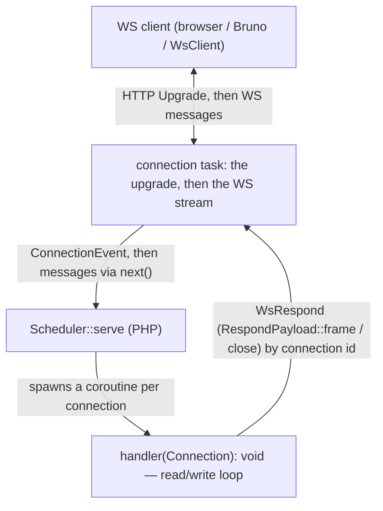

English | [Русский](websocket-server.ru.md)

# WebSocket server

A long-lived WebSocket server: the network lives in the extension, and every
upgraded connection is streamed into PHP and handled in its own coroutine (a PHP
Fiber the scheduler runs). It is a
hybrid — the listener and the handshake are the same HTTP layer the
[HTTP server](http-server.md) runs on (`hyper`), and after the upgrade the
connection works in the push model of the [socket server](socket-server.md). It
runs under the same
[worker master](worker-master.md).

## How it works

A connection starts as an ordinary HTTP request with `Upgrade: websocket`. A
request with a valid upgrade is accepted by
[`fastwebsockets`](https://github.com/denoland/fastwebsockets) and becomes a
bidirectional message stream. A request without an upgrade gets `426 Upgrade
Required`; an upgrade on a path other than `path` gets `404`, one whose `Origin`
`allowedOrigins` does not list gets `403`, and a malformed upgrade gets `400`.
Framing is the WS protocol
itself (opcode, client masking, ping/pong/close control frames, UTF-8 validation
of text), not the length-prefix of the socket server, so the WS server has its
own inbound message stream on top of the upgraded connection.



## Quick start

```php
use SConcur\Features\WsServer\Dto\Connection;
use SConcur\Features\WsServer\WsServer;

$server = new WsServer(address: '0.0.0.0:9200');

$server->serve(static function (Connection $connection): void {
    // echo: read messages and send them back while the connection is alive
    while (($message = $connection->read()) !== null) {
        $connection->write($message);
    }
});
```

The handler — `Closure(Connection): void` — runs in the connection's coroutine and
drives its lifecycle itself; when it returns, the connection is closed
automatically.

## Connection: read / write / close

`Connection` (`src/Features/WsServer/Dto/Connection.php`, shared base class —
`src/Features/Socket/Dto/AbstractConnection.php`):

| Member | Description |
| --- | --- |
| `read(): ?string` | the next inbound message; `null` — the client closed its side, the connection ended, or `maxMessageBytes` was exceeded. Cooperatively suspends the coroutine |
| `write(string $data, bool $binary = false): void` | send a message; waits until it has actually been flushed, so a fast handler cannot outrun the client. Text by default. Throws `WsServerConnectionClosedException` if the connection is gone |
| `lastMessageWasBinary(): bool` | whether the last `read()` returned a binary message |
| `close(): void` | close the connection (idempotent; does nothing if the connection is already gone) |
| `isClosed(): bool` | whether the connection is closed |
| `id`, `remoteAddr`, `localAddr`, `path`, `subprotocol` | identifier, addresses, upgrade path and the negotiated subprotocol |

`read()` returns the payload as a binary-safe string; `write()` sends text by
default (friendly to browsers and Bruno), and `binary: true` sends arbitrary bytes:

```php
$connection->write($message, binary: $connection->lastMessageWasBinary()); // echo, preserving the type
```

Inside the handler you can make async calls (Sleeper, Mongodb, SQL, HTTP client)
between reads and writes — the coroutine suspends cooperatively and other
connections keep being served.

## Server push

The handler is not required to reply to every inbound message and may push as many
as it wants, including without any inbound:

```php
$server->serve(static function (Connection $connection): void {
    $connection->read();

    for ($index = 0; $index < 10; $index++) {
        $connection->write("update-$index");

        Sleeper::sleep(seconds: 1); // async work runs between pushes
    }
});
```

Broadcast to other connections is not built in — the application can keep
references to `Connection` and write to them itself (`write` is routed by `id` on
the extension).

## Parameters

The `WsServer` constructor; the PHP defaults mirror the extension's.

| Parameter | Default | Purpose |
| --- | --- | --- |
| `address` | `0.0.0.0:9200` | listener address `host:port`, or `fd://N` — a listening socket bound elsewhere (systemd socket activation, say; `reusePort` must then stay off), see [one socket for the whole pool](http-server.md#one-socket-for-the-whole-pool) |
| `handshakeTimeoutMs` | `10000` | accepted and not applied |
| `idleTimeoutMs` | `0` (off) | idle timeout between inbound frames — data messages and the client's pongs, so a client that answers the keepalive ping stays connected |
| `writeTimeoutMs` | `30000` | max time to send one message (and one ping) |
| `pingIntervalMs` | `30000` | server keepalive ping cadence (`0` — off) |
| `maxMessageBytes` | `1048576` (1 MiB) | size limit of a single inbound message; exceeding it closes the connection with code 1009 |
| `maxConcurrency` | `0` (no limit) | max connections served at once; excess ones wait for a free slot |
| `handlerTimeoutMs` | `0` (no limit) | how long one connection handler may run before it is unwound where it stands — see [coroutine timeout](coroutine-timeout.md) |
| `maxConnections` | `0` (no limit) | stop the server after N served connections (a leak guard); spread under the master, see [restart policy](worker-master.md#restart-policy-and-maxrequests) |
| `shutdownTimeoutMs` | `10000` | accepted and not applied: finishing the connections already accepted is bounded by the grace period below, not by a clock of its own |
| `reusePort` | `false` | `SO_REUSEPORT` — a pool of processes on one port (Linux) |
| `path` | `/` | the path on which the upgrade is accepted (empty string — any path); another path → `404` |
| `allowedOrigins` | `[]` | hosts the `Origin` header may name, port included, compared ignoring case; `*` — any (empty — the check is skipped; a request without `Origin` always passes) |
| `subprotocols` | `[]` | negotiable WebSocket subprotocols; the first one in this list that the client offers wins |
| `onError` | `null` | handler-error hook |
| `masterPid` | `null` | orphan check: `null` — the master that forked this worker (`WorkerContext`), or none outside one |
| `telemetrySocket` | `null` | unix socket for stats snapshots ([stats](admin-stats.md)); `''` — off; `null` — `SCONCUR_TELEMETRY_SOCKET`, which the master sets for its workers |
| `serverName` | `null` | worker name in the stats snapshots; `null` — `SCONCUR_SERVER_NAME`, which the master sets, or `sconcur-server` |
| `telemetryIntervalMs` | `null` | snapshot cadence (`0` — the default of the component that sends them, 1000 ms; `null` — `SCONCUR_TELEMETRY_INTERVAL_MS` from the environment, or that default) |
| `preemptionQuantumMs` | `0` | automatic-preemption quantum (`0` — off); read [process-wide state](coroutine-switching.md#process-wide-state) before turning it on |

`allowedOrigins`/`subprotocols` are arrays, and `fromArgs()` takes only scalar
parameters from argv: a `--allowedOrigins=…` flag is rejected as unknown. Set them in
the constructor.

## Concurrency, keepalive and errors

Concurrency is between connections: each lives in its own coroutine.
`maxConcurrency` limits how many are served at once (a slot is held for the whole
lifetime of a connection); excess connections complete the handshake and then wait
for a free slot before they are read or served. The same CPU-bound
caveat as everywhere applies: a native blocking call freezes the single PHP thread,
and so does a CPU loop in PHP code, unless preemption is on — then it is preempted
every [quantum](coroutine-switching.md).

The server pings the client every `pingIntervalMs`, which keeps a push-only connection
alive when the client sends nothing. It does not wait for the pong: a ping that cannot
be written within `writeTimeoutMs` ends the connection, and a peer that is gone but
still accepts bytes is caught only by `idleTimeoutMs`. `idleTimeoutMs` (if set) ends a
connection's input when too much time passes between inbound frames; the client's
pongs count, so with `pingIntervalMs` below `idleTimeoutMs` a quiet client that
answers the pings stays connected. A message larger than `maxMessageBytes` closes the
connection with code 1009, and on the handler side `read()` returns `null`.

If the handler throws, the exception is caught, the connection is closed, and the
`onError: Closure(Throwable, Connection): void` hook can observe it and send a
final message before the close. In ordinary code `write` throws
`WsServerConnectionClosedException` once the client has disconnected.

## Graceful shutdown and SO_REUSEPORT

On a signal (SIGTERM/SIGINT), on reaching `maxConnections`, or on being orphaned
(`masterPid`), the server stops accepting new connections and ends the input of
the active ones: a handler reading in a loop gets `null` (its current write
still goes through) and returns. A connection that has not sent its first message
yet gets 250 ms more for it. A push-only handler that does not read is
finished by a forced close once the grace period elapses (2 s). In a pool on one
port the kernel immediately hands new connections to the siblings, and the process
exits on its own.

Lifecycle lines go to `STDOUT`. The WebSocket server writes no access lines:
`accessLog` of a master group has nothing to direct for it.

```
2026-06-28T12:00:00.000000 sconcur ws server listening on 0.0.0.0:9200 pid=12345 version=X.Y.Z maxConcurrency=0 maxConnections=0 reusePort=0
2026-06-28T12:00:01.000000 sconcur ws server shutdown: stop accepting (reason=signal), draining 2 in-flight
2026-06-28T12:00:01.050000 sconcur ws server shutdown: drained all in-flight
2026-06-28T12:00:01.060000 sconcur ws server shutdown: stopped
```

## Running under the worker master

A group's role builds the server and serves; the master needs to know nothing about it.

```php
new WorkerGroupConfig(
    name: 'ws',
    role: static function (): void {
        new WsServer(address: '0.0.0.0:9200', reusePort: true)
            ->serve(static function (Connection $connection): void {
                while (($message = $connection->read()) !== null) {
                    $connection->write($message);
                }
            });
    },
    workerCount: 4,
);
```

Under a master the server watches it on its own (`WorkerContext`); `reusePort: true` lets
the workers share the port. The pool reports statistics through the master panel
(`GET /api/stats`) via the `connections` section, as in the socket server — see
[worker master](worker-master.md) and [server statistics](admin-stats.md).
`WsServer::fromArgs($_SERVER['argv'])` builds the same server from `--key=value` flags,
for a script that runs one on its own.

## Limits

- TCP only, no unix sockets.
- A single endpoint: there are no application HTTP routes — anything that is not an
  upgrade is `426`.
- Broadcast is not built in.
- No per-message timeout: the bounds are the idle timeout, `writeTimeoutMs`, the
  keepalive ping and the graceful stop.
- No `permessage-deflate` (compression): `fastwebsockets` does not support it.
- No TLS: terminate it in front, as for the HTTP server.
- The library's general limits are in the
  [README](../README.md#use-and-limitations).
