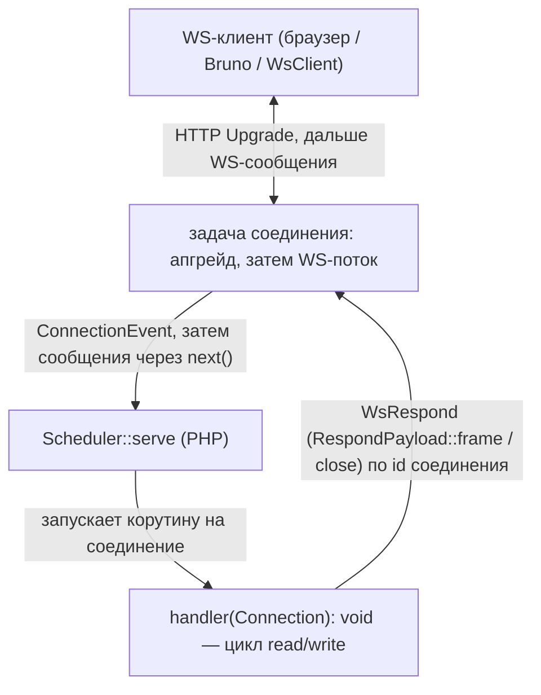

[English](websocket-server.md) | Русский

# WebSocket-сервер

Долгоживущий WebSocket-сервер: сеть живёт в расширении, а каждое поднятое до WS
соединение передаётся потоком в PHP и обрабатывается в своей корутине (PHP Fiber,
которым управляет планировщик). Это гибрид: приём соединений и рукопожатие идут
через тот же HTTP-слой, на котором работает [HTTP-сервер](http-server.ru.md)
(`hyper`), а после апгрейда соединение работает
в push-модели [сокет-сервера](socket-server.ru.md). Работает под тем же
[мастером воркеров](worker-master.ru.md).

## Как это работает

Соединение начинается обычным HTTP-запросом с `Upgrade: websocket`. Запрос с
валидным апгрейдом принимает
[`fastwebsockets`](https://github.com/denoland/fastwebsockets), и он становится
двунаправленным потоком сообщений. Запрос без апгрейда получает `426 Upgrade
Required`; апгрейд не на настроенный `path` — `404`, с `Origin`, которого нет в
`allowedOrigins`, — `403`, а некорректный апгрейд — `400`. Фрейминг — это сам
WS-протокол (opcode, маскирование клиента, управляющие кадры ping/pong/close,
валидация UTF-8 у текста), а не length-prefix сокет-сервера, поэтому у
WS-сервера свой поток входящих сообщений поверх поднятого соединения.



## Быстрый старт

```php
use SConcur\Features\WsServer\Dto\Connection;
use SConcur\Features\WsServer\WsServer;

$server = new WsServer(address: '0.0.0.0:9200');

$server->serve(static function (Connection $connection): void {
    // echo: читаем сообщения и отправляем обратно, пока соединение живо
    while (($message = $connection->read()) !== null) {
        $connection->write($message);
    }
});
```

Обработчик — `Closure(Connection): void` — исполняется в корутине соединения и сам
ведёт его жизненный цикл; когда он возвращает управление, соединение закрывается
автоматически.

## Connection: read / write / close

`Connection` (`src/Features/WsServer/Dto/Connection.php`, общий базовый класс —
`src/Features/Socket/Dto/AbstractConnection.php`):

| Член | Описание |
| --- | --- |
| `read(): ?string` | следующее входящее сообщение; `null` — клиент закрыл свою сторону, соединение завершилось или превышен `maxMessageBytes`. Кооперативно приостанавливает корутину |
| `write(string $data, bool $binary = false): void` | отправить сообщение; ждёт, пока оно реально не будет сброшено в сеть, поэтому быстрый обработчик не обгоняет клиента. По умолчанию текст. Бросает `WsServerConnectionClosedException`, если соединения уже нет |
| `lastMessageWasBinary(): bool` | было ли последнее `read()` бинарным |
| `close(): void` | закрыть соединение (идемпотентно; если соединение уже разорвано, ничего не делает) |
| `isClosed(): bool` | закрыто ли соединение |
| `id`, `remoteAddr`, `localAddr`, `path`, `subprotocol` | идентификатор, адреса, путь апгрейда и согласованный субпротокол |

`read()` отдаёт полезную нагрузку бинарно-безопасной строкой; `write()` по
умолчанию шлёт текст (это дружественно браузеру и Bruno), а `binary: true` — любые
байты:

```php
$connection->write($message, binary: $connection->lastMessageWasBinary()); // echo с сохранением типа
```

Внутри обработчика между чтениями и записями можно делать асинхронные вызовы
(Sleeper, Mongodb, SQL, HTTP-клиент) — корутина приостанавливается кооперативно, а
другие соединения продолжают обслуживаться.

## Server push

Обработчик не обязан отвечать на каждое входящее сообщение и может отправлять
сколько угодно сообщений, в том числе вообще без входящих:

```php
$server->serve(static function (Connection $connection): void {
    $connection->read();

    for ($index = 0; $index < 10; $index++) {
        $connection->write("update-$index");

        Sleeper::sleep(seconds: 1); // между отправками идёт асинхронная работа
    }
});
```

Broadcast в другие соединения не встроен — приложение может держать ссылки на
`Connection` и писать в них само (`write` маршрутизируется по `id` на стороне расширения).

## Параметры

Конструктор `WsServer`; значения по умолчанию в PHP совпадают со значениями
расширения.

| Параметр | По умолчанию | Назначение |
| --- | --- | --- |
| `address` | `0.0.0.0:9200` | адрес прослушивания `host:port` или `fd://N` — слушающий сокет, связанный кем-то другим (например, socket activation systemd; `reusePort` тогда должен быть выключен), см. [один сокет на весь пул](http-server.ru.md#один-сокет-на-весь-пул) |
| `handshakeTimeoutMs` | `10000` | принимается и не применяется |
| `idleTimeoutMs` | `0` (выкл.) | таймаут простоя между входящими кадрами — сообщениями с данными и pong клиента, поэтому клиент, отвечающий на keepalive-ping, остаётся подключённым |
| `writeTimeoutMs` | `30000` | максимальное время отправки одного сообщения (и одного ping) |
| `pingIntervalMs` | `30000` | период серверного keepalive-ping (`0` — выкл.) |
| `maxMessageBytes` | `1048576` (1 MiB) | лимит размера одного входящего сообщения; превышение закрывает соединение с кодом 1009 |
| `maxConcurrency` | `0` (без лимита) | сколько соединений обслуживается одновременно; лишние ждут слот |
| `handlerTimeoutMs` | `0` (без лимита) | сколько один обработчик соединения может работать, прежде чем его размотают там, где он стоит — см. [таймаут корутины](coroutine-timeout.ru.md) |
| `maxConnections` | `0` (без лимита) | остановить сервер после N обслуженных соединений (защита от утечек); под мастером разбрасывается, см. [политику перезапуска](worker-master.ru.md#политика-перезапуска-и-maxrequests) |
| `shutdownTimeoutMs` | `10000` | принимается и не применяется: завершение уже принятых соединений ограничено льготным периодом ниже, а не собственными часами |
| `reusePort` | `false` | `SO_REUSEPORT` — пул процессов на одном порту (Linux) |
| `path` | `/` | путь, на котором принимается апгрейд (пустая строка — любой путь); другой путь → `404` |
| `allowedOrigins` | `[]` | хосты, которые может называть заголовок `Origin`, вместе с портом, без учёта регистра; `*` — любой (пусто — проверка пропускается; запрос без `Origin` проходит всегда) |
| `subprotocols` | `[]` | согласуемые субпротоколы WebSocket; выбирается первый из этого списка, который предлагает клиент |
| `onError` | `null` | хук ошибки обработчика |
| `masterPid` | `null` | проверка на сироту: `null` — мастер, форкнувший этот воркер (`WorkerContext`), а вне мастера проверки нет |
| `telemetrySocket` | `null` | unix-сокет для снапшотов статистики ([статистика](admin-stats.ru.md)); `''` — выкл.; `null` — `SCONCUR_TELEMETRY_SOCKET`, который мастер ставит своим воркерам |
| `serverName` | `null` | имя воркера в снапшотах статистики; `null` — `SCONCUR_SERVER_NAME`, который ставит мастер, или `sconcur-server` |
| `telemetryIntervalMs` | `null` | период снапшотов (`0` — значение по умолчанию у отправителя, 1000 мс; `null` — `SCONCUR_TELEMETRY_INTERVAL_MS` из окружения или это значение) |
| `preemptionQuantumMs` | `0` | квант автоматической преемпции (`0` — выкл.); перед включением прочитайте про [состояние процесса](coroutine-switching.ru.md#состояние-процесса) |

`allowedOrigins`/`subprotocols` — массивы, а `fromArgs()` берёт из argv только
скалярные параметры: флаг `--allowedOrigins=…` отклоняется как неизвестный.
Задавайте их в конструкторе.

## Конкурентность, keepalive и ошибки

Конкурентность — между соединениями: каждое живёт в своей корутине.
`maxConcurrency` ограничивает число одновременно обслуживаемых (слот держится всю
жизнь соединения); лишние соединения проходят рукопожатие и ждут слот, прежде чем
их начнут читать и обслуживать. Действует та же оговорка про CPU:
нативный блокирующий вызов замораживает единственный PHP-поток, и цикл вычислений
на PHP тоже, если не включена преемпция, — тогда он вытесняется каждый
[квант](coroutine-switching.ru.md).

Сервер пингует клиента каждые `pingIntervalMs`, и это держит живым
push-соединение, в которое клиент ничего не шлёт. Ответного pong сервер не ждёт:
соединение завершается, если ping не удалось записать за `writeTimeoutMs`, а
пропавшего клиента, соединение с которым всё ещё принимает байты, ловит только
`idleTimeoutMs`.
`idleTimeoutMs` (если задан) завершает вход соединения, когда между входящими
кадрами проходит слишком много времени; pong клиента тоже считается, поэтому при
`pingIntervalMs` меньше `idleTimeoutMs` молчащий клиент, отвечающий на ping,
остаётся подключённым. Сообщение больше `maxMessageBytes`
закрывает соединение с кодом 1009, а на стороне обработчика `read()` возвращает
`null`.

Если обработчик бросил исключение, оно перехватывается, соединение закрывается, а
хук `onError: Closure(Throwable, Connection): void` может его увидеть и отправить
прощальное сообщение перед закрытием. В обычном коде `write` бросает
`WsServerConnectionClosedException`, когда клиент уже отключился.

## Мягкая остановка и SO_REUSEPORT

По сигналу (SIGTERM/SIGINT), при достижении `maxConnections` или при осиротении
(`masterPid`) сервер перестаёт принимать новые соединения и завершает вход
активных: обработчик, читающий в цикле, получает `null` (текущая запись всё же
проходит) и возвращает управление. Соединению, которое ещё не прислало первое
сообщение, на него даётся ещё 250 мс. Push-обработчик, который не читает,
добивается принудительным закрытием по истечении льготного периода (2 c). В пуле
на одном порту ядро сразу отдаёт новые соединения соседям, и процесс выходит сам.

Строки жизненного цикла идут в `STDOUT`. Access-строк WebSocket-сервер не пишет:
`accessLog` группы мастера для него ничего не меняет.

```
2026-06-28T12:00:00.000000 sconcur ws server listening on 0.0.0.0:9200 pid=12345 version=X.Y.Z maxConcurrency=0 maxConnections=0 reusePort=0
2026-06-28T12:00:01.000000 sconcur ws server shutdown: stop accepting (reason=signal), draining 2 in-flight
2026-06-28T12:00:01.050000 sconcur ws server shutdown: drained all in-flight
2026-06-28T12:00:01.060000 sconcur ws server shutdown: stopped
```

## Запуск под мастером воркеров

Роль группы строит сервер и запускает его; мастеру ничего о нём знать не нужно.

```php
new WorkerGroupConfig(
    name: 'ws',
    role: static function (): void {
        new WsServer(address: '0.0.0.0:9200', reusePort: true)
            ->serve(static function (Connection $connection): void {
                while (($message = $connection->read()) !== null) {
                    $connection->write($message);
                }
            });
    },
    workerCount: 4,
);
```

Под мастером сервер сам следит за ним (`WorkerContext`); `reusePort: true` позволяет
воркерам делить порт. Пул отдаёт статистику через панель мастера (`GET /api/stats`)
секцией `connections`, как у сокет-сервера, — см. [мастер воркеров](worker-master.ru.md)
и [статистику сервера](admin-stats.ru.md). `WsServer::fromArgs($_SERVER['argv'])`
собирает тот же сервер из флагов `--key=value` — для скрипта, который запускает один
сервер сам по себе.

## Ограничения

- Только TCP, unix-сокетов нет.
- Единственный эндпоинт: прикладных HTTP-маршрутов нет — всё, что не апгрейд,
  это `426`.
- Broadcast не встроен.
- Нет таймаута на сообщение: границы задают таймаут простоя, `writeTimeoutMs`,
  keepalive-ping и мягкая остановка.
- Нет `permessage-deflate` (сжатия): `fastwebsockets` его не поддерживает.
- Нет TLS: терминируйте его впереди, как и для HTTP-сервера.
- Общие ограничения библиотеки — в
  [README](../README.ru.md#применение-и-ограничения).
