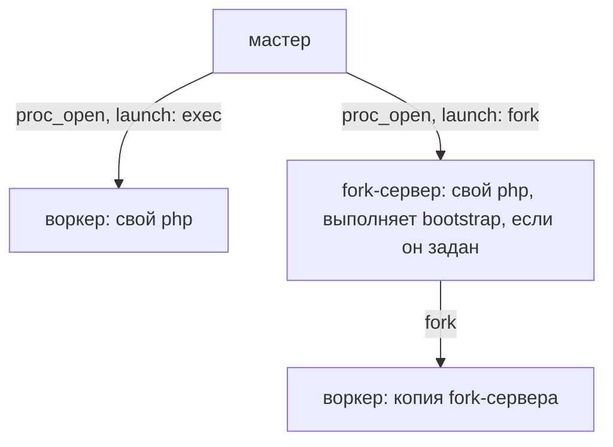

[English](worker-master.md) | Русский

# Мастер воркеров

Супервизор, который поднимает и стережёт пулы процессов-воркеров, каждый пул — со своим
скриптом. Воркеры пула делят один порт — у каждого свой сокет
[`SO_REUSEPORT`](http-server.ru.md#масштабирование-на-ядра-so_reuseport) или все на
одном сокете, который связывает мастер, — так что сервер масштабируется на все ядра без
балансировщика перед ним. Реализация — `src/Worker/` плюс универсальный CLI
`bin/sconcur-server`.

Каждый воркер — отдельный процесс: по умолчанию копия fork-сервера, который мастер
запускает для группы и который загружает приложение один раз, или свой `php`, запущенный
через `proc_open` (см. [Запуск: exec или fork](#запуск-exec-или-fork)). Мастер тоже
загружает расширение и принимает и отправляет сигналы через него, поэтому ни
`pcntl`, ни `posix` не нужны; `start` без расширения падает с
`ExtensionNotLoadedException`. Мастер никогда не форкает и не поднимает рантайм
расширения: асинхронной работы у него нет.

В обоих случаях воркеру достаются его stdin/stdout/stderr и ни одного собственного
дескриптора мастера: иначе в потомке остались бы открытыми все дескрипторы мастера —
телеметрийные сокеты, соединения панели, блокировка и журнал, — поэтому при запуске
воркера все они направляются в `/dev/null`. Fork-воркер сохраняет ещё и то, что открыл
bootstrap его группы (см. [Загрузка приложения один
раз](#загрузка-приложения-один-раз-bootstrap)).

Программа, которую запускает воркер, — `shell_exec`, `proc_open`, сайдкар — получает свои
stdin/stdout/stderr и больше ничего из воркера: ни этих заглушек на `/dev/null`, ни пайпа
heartbeat, ни слушающего сокета группы. Всё, что мастер передал воркеру, к началу его
скрипта помечено close-on-exec, поэтому программа, пережившая воркер, не удержит порт после
остановки пула. То, что приложение открывает само, остаётся таким, каким приложение его
открыло.

## Оглавление

- [Быстрый старт](#быстрый-старт)
- [Команды](#команды)
- [Параметры](#параметры)
- [Запуск: exec или fork](#запуск-exec-или-fork)
- [Готовность](#готовность)
- [Политика перезапуска и `maxRequests`](#политика-перезапуска-и-maxrequests)
- [Группа, которая так и не поднялась](#группа-которая-так-и-не-поднялась)
- [Соединения с базами данных](#соединения-с-базами-данных)
- [Самозавершение осиротевших воркеров](#самозавершение-осиротевших-воркеров)
- [Зависший воркер](#зависший-воркер)
- [Логирование](#логирование)
- [Единственный инстанс и состояние](#единственный-инстанс-и-состояние)
- [Мягкая остановка](#мягкая-остановка)
- [Тестирование](#тестирование)

## Быстрый старт

Вы пишете только воркер-скрипт; мастер берётся готовым из `bin/`.

```php
// worker.php
use Nyholm\Psr7\Factory\Psr17Factory;
use Psr\Http\Message\ResponseInterface;
use Psr\Http\Message\ServerRequestInterface;
use SConcur\Features\HttpServer\HttpServer;

require __DIR__ . '/vendor/autoload.php';

$factory = new Psr17Factory();

// fromArgs() собирает сервер из argv: мастер передаёт сюда ключи блока `server`
// как флаги --key=value и свой pid как --masterPid.
$server = HttpServer::fromArgs(
    argv: $_SERVER['argv'],
    serverRequestFactory: $factory,
    responseFactory: $factory,
);

$server->serve(static fn (ServerRequestInterface $request): ResponseInterface =>
    $factory->createResponse(200)->withBody($factory->createStream('ok')));
```

> **Нескольким воркерам на одном порту нужен `reusePort: true` в блоке `server` группы
> или `listen` у группы — иначе второй воркер получит `EADDRINUSE`.** См.
> [как делить порт](#как-делить-порт-reuseport-или-listen).

```json
{
  "phpArgs": ["-d", "extension=/app/ext/build/sconcur.so"],
  "runtimeDir": "/run/sconcur",
  "logDir": "/var/log/sconcur",
  "rotateDays": 3,
  "groups": [
    {
      "name": "http",
      "workerScript": "/app/worker.php",
      "workerCount": 8,
      "server": {
        "address": "0.0.0.0:8080",
        "reusePort": true,
        "maxRequests": 10000
      }
    }
  ]
}
```

Мастер стережёт одну или несколько **групп**, и они не обязаны быть
однотипными. Один супервизор, один lock, один журнал и одна панель держат
HTTP-пул и пару пулов консьюмеров очередей разом:

```json
{
  "phpArgs": ["-d", "extension=/app/ext/build/sconcur.so"],
  "runtimeDir": "/run/sconcur",
  "groups": [
    {
      "name": "http",
      "workerScript": "/app/worker.php",
      "workerCount": 8,
      "server": { "address": "0.0.0.0:8080", "reusePort": true }
    },
    {
      "name": "orders",
      "workerScript": "/app/consumer.php",
      "workerCount": 2,
      "server": {
        "queues": [{ "name": "orders", "coroutineCount": 8 }]
      }
    }
  ]
}
```

Всё, что нужно пулу, лежит в его группе. Плоская форма — `workerScript`,
`workerCount`, `workerArgs` и `server` на верхнем уровне, один пул на мастер —
больше не читается: конфиг, где эти ключи остались, отвергается при загрузке с
`... belong to a group now — move them into an entry of "groups"`. Перевод
сводится к тому, чтобы завернуть бывший верхний уровень в одну запись `groups`
и дать ей `name`.

```sh
php -d extension=/app/ext/build/sconcur.so vendor/bin/sconcur-server start --configPath=/app/master.json
```

Расширение мастер загружает сам — здесь через `-d` или через `php.ini`. Воркеры тоже
загружают его, через `phpArgs` или свой `php.ini`: exec-воркер — свой `php`, а
fork-воркер — копия fork-сервера своей группы, который запускается так же.

`start` работает на переднем плане и стережёт пул до `SIGTERM`/`SIGINT`, до удаления
state-файла или пока все воркеры не завершатся так, что перезапускать нечего.

Программный API за CLI — `SConcur\Worker\WorkerMaster`:

```php
MasterConfig::fromFile('/app/master.json')->toWorkerMaster()->run();
```

Сам `WorkerMaster` принимает группы объектами `WorkerGroupConfig` — их и собирает
`MasterConfig` из файла.

## Команды

Каждая команда принимает `--configPath`; `--group` сужает `status` и `reload` до
одного пула. `start` и `stop` его тоже принимают и отвергают имя, которого нет в
конфиге, но работают со всем конфигом. Один и тот же конфиг
во всех командах гарантирует согласованные `runtimeDir`/`name`, поэтому
`status`/`stop`/`reload` находят lock-, state- и триггер-файлы.

```sh
vendor/bin/sconcur-server start   --configPath=/app/master.json  # поднять пулы (на переднем плане)
vendor/bin/sconcur-server status  --configPath=/app/master.json  # running: pid=12345 workers=8 groups=2
vendor/bin/sconcur-server stop    --configPath=/app/master.json  # удалить state-файл и дождаться выхода
vendor/bin/sconcur-server reload  --configPath=/app/master.json  # перечитать конфиг и прокатить воркеры
vendor/bin/sconcur-server reload  --configPath=/app/master.json --group=orders  # прокатить один пул
```

`--group=NAME` сужает `status` до одного пула, а `reload` — до проката одного,
оставляя соседей на месте. Имя, которого в конфиге нет, — ошибка использования
(код `2`). `stop` берёт мастера целиком: lock и state-файл одни, останавливать
половину нечем.

Коды возврата: у `start` — собственный код мастера: `0` после остановки, `70`, если
группа так и не поднялась (см. [ниже](#группа-которая-так-и-не-поднялась)), `1`, если
он не смог стартовать; `status` — `0` (работает) / `3` (остановлен или протухший
state); `stop` — `0` после остановки (или если никто не работал), `1` по таймауту;
`reload` — `0` по завершении, `3` если мастер не запущен, `1` по таймауту, а также
когда мастер перезагрузку отклонил или отменил — причина печатается
(`reload failed: …`) и есть в журнале.

`status` печатает итог, а следом по строке на группу.

`reload` перечитывает конфиг и переводит воркеры на него. Команда создаёт
триггер-файл `<runtimeDir>/<name>.reload` с именем конфига; мастер читает его, а
затем перезапускает воркеры каждой группы по одному, начиная с нового:

1. Поднимает замену рядом с воркером слота.
2. Ждёт, пока замена сообщит, что поднялась (см. [готовность](#готовность)), не
   дольше `readyTimeoutMs`.
3. Замена занимает слот, а старый воркер получает `SIGTERM`: перестаёт принимать,
   доводит до конца начатые запросы и выходит; после `shutdownTimeoutMs` — `SIGKILL`.
4. Когда старого воркера больше нет — следующий слот.

Пока группа перезапускается, воркеров в ней не меньше `workerCount` и не больше чем на
один сверх него. Свежий `php worker.php` подхватывает новый код с диска.
[Fork-группа](#запуск-exec-или-fork) переходит на новое поколение: мастер запускает новый
fork-сервер, который заново загружает с диска bootstrap — приложение, эту библиотеку,
расширение, — и переносит на него слоты по одному, как описано выше, а старый
fork-сервер отпускает каждый; когда у него не остаётся слотов, его останавливают. Новый
fork-сервер, который не загрузился, отменяет перезагрузку раньше, чем тронут хоть один
воркер.

Старый воркер и его замена какое-то время работают одновременно, поэтому должны уметь
делить порт: `reusePort: true` в `server` или `listen` у группы. Воркер, который
связывает свой адрес единолично, так не заменить — замена не сможет связать адрес, и
перезагрузка будет отменена.

Если замена вышла, не успев подняться, или не поднялась за `readyTimeoutMs`,
перезагрузка отменяется:

- замену останавливают, а слоты, до которых перезагрузка не дошла, остаются при своих
  воркерах;
- у exec-группы слоты, которые она уже прошла, остаются с новыми воркерами: те
  поднялись; fork-группа тем же способом возвращает их старому поколению и
  останавливает новый fork-сервер, так что поколение у группы остаётся одно;
- прежние настройки группы возвращаются, так что воркер, упавший позже, поднимется на
  том, что работало, а не на том, что не поднялось;
- в журнале — `group <name>: reload given up: <причина>`, а `reload` выходит с `1` и
  той же причиной.

Версия, которая падает на старте, стоит одной замены, а не всего пула.

Что перезагрузка меняет: состав групп (добавленная поднимается, у удалённой
воркеры доделывают работу, и её не заменяют), а у каждой группы — `workerCount`,
`workerScript`, `workerArgs`, `server`, `env`, `launch`, `bootstrap`, `phpBinary`,
`phpArgs`, `restartPolicy`, `accessLog`, таймауты и задержки перезапуска.
Отмасштабировать пул — значит поправить конфиг и сделать `reload`, а не перезапускать
мастера.

Чего не меняет: `runtimeDir` и `name` идентифицируют работающий экземпляр, а
`panelPort`, `adminToken` и `logDir` привязаны на старте. Перезагрузка читает новые
значения и молча их игнорирует — применяет их только полный рестарт. `listen` группы —
единственное исключение, которое не игнорируется, а отвергается: её воркеры принимают
соединения на сокете, который мастер связал при старте, поэтому перезагрузку, которая
его переносит, мастер отклоняет с причиной в журнале. Группа, добавленная
перезагрузкой, получает свой сокет в этот момент, а у удалённой сокет закрывается,
когда её воркеры доработали; `start`, у которого адрес `listen` занят, падает раньше,
чем запустится хоть один воркер.

Конфиг, который не разбирается или называет несуществующий `workerScript` или
`bootstrap`, отвергается, и мастер продолжает работать на прежнем. Опечатка не должна гасить
работающий пул; отказ и его причина уходят в журнал. То же и с триггером, который
называет файл конфига, которого мастер не находит, — поэтому CLI приводит путь к
абсолютному, прежде чем его записать: мастер читает его из своего рабочего каталога,
а не из каталога оператора.

## Параметры

Конфиг валидируется строго (ошибка → код выхода `2`): неизвестный ключ отвергается
на обоих уровнях (защита от опечаток вроде `wokerCount`), `name` на обоих уровнях
ограничен набором `[A-Za-z0-9._-]` (это компонент пути, glob ротации и значение
`--group`), а все таймауты, счётчики и срок хранения должны быть `>= 0`.

### Мастер

| Ключ | По умолчанию | Назначение |
|---|---|---|
| `groups` | — (обязателен) | Пулы, которые стеречь; хотя бы один. |
| `runtimeDir` | временный каталог | Каталог lock- и state-файлов (локальная ФС). |
| `logDir` | `runtimeDir` | Каталог логов. |
| `name` | `sconcur-server` | Префикс имён лога и state-файла. |
| `rotateDays` | `3` | Сколько дней хранить файлы лога. |
| `logTo` | `file` | `file` \| `stdout` \| `both` (для `docker logs` — `stdout`/`both`). |
| `panelPort` | `0` (выкл.) | Порт встроенной [панели телеметрии](admin-stats.ru.md); нужен вместе с `adminToken`. |
| `adminToken` | пусто (выкл.) | Bearer-токен панели; нужен вместе с `panelPort`. |

Следующие ключи — умолчания, которые наследует каждая группа, если не задала своё:
`launch`, `phpBinary`, `phpArgs`, `env`, `restartPolicy`, `shutdownTimeoutMs`,
`restartBackoffMs`, `maxRestartBackoffMs`, `watchdogTimeoutMs`, `readyTimeoutMs`,
`accessLog`.

### Группа

| Ключ | По умолчанию | Назначение |
|---|---|---|
| `name` | — (обязателен) | Имя пула в журнале, в `status` и в `--group`. Уникально. |
| `workerScript` | — (обязателен) | Скрипт, который запускает каждый её воркер. Относительный путь берётся от рабочего каталога мастера — см. [пути и симлинки](#пути-и-симлинки). |
| `workerCount` | `0` (= число логических CPU, как их считает `nproc` — вдвое больше числа ядер, если включён гипертрединг) | Сколько воркеров поднять. |
| `server` | `{}` | Параметры воркера → разворачиваются в его `argv`. |
| `workerArgs` | `[]` | Дополнительные сырые флаги `argv` воркера, после `server`. |
| `listen` | пусто | Адрес, который мастер связывает один раз и передаёт каждому воркеру группы как `--listenFd`, — [один сокет на весь пул](http-server.ru.md#один-сокет-на-весь-пул) вместо `SO_REUSEPORT`. Несовместим с `reusePort` и `listenFd` в `server`. |
| `launch` | мастерский (`fork`) | `fork` — копия fork-сервера группы; `exec` — свой `php` на скрипте. См. [Запуск: exec или fork](#запуск-exec-или-fork). |
| `phpBinary` | мастерский | Интерпретатор для воркеров этой группы — при `fork` для её fork-сервера, копиями которого они являются. |
| `phpArgs` | мастерские | Флаги интерпретатора, например `["-d", "extension=…"]`; при `fork` — fork-сервера. |
| `bootstrap` | пусто | Файл, который fork-сервер `fork`-группы загружает один раз на поколение, прежде чем форкать воркеров, — см. [загрузку приложения один раз](#загрузка-приложения-один-раз-bootstrap). Относительный путь берётся от рабочего каталога мастера. |
| `env` | мастерский | Доп. env воркера, поверх мастерского и унаследованного. |
| `restartPolicy` | мастерская | `always` \| `on-failure` \| `never`. |
| `shutdownTimeoutMs` | мастерский | Сколько ждать завершения воркера до `SIGKILL`. |
| `restartBackoffMs` | мастерский | Начальная задержка перед перезапуском воркера, который раз за разом падает на старте; удваивается с каждым таким падением. |
| `maxRestartBackoffMs` | мастерский | Предел этой задержки. |
| `watchdogTimeoutMs` | мастерский (`60000`) | Сколько воркеру позволено не подавать признаков жизни, прежде чем его убьют и заменят — см. [зависший воркер](#зависший-воркер). `0` выключает надзор; любое другое значение — не меньше 5000. |
| `readyTimeoutMs` | мастерский (`30000`) | Сколько `reload` ждёт, пока каждая замена сообщит, что поднялась, прежде чем отменить перезагрузку, — см. [готовность](#готовность). Не меньше 1000; выключить нельзя. |
| `accessLog` | мастерский (`stdout`) | Куда воркеры пишут access-строки: `stdout` — в журнал, через мастер или fork-сервер, которые под большой нагрузкой часть строк теряют; `file` — каждый воркер сам в файл дня; `off` — никуда. См. [access-строки](#access-строки). |

Блок `server` — чистая переадресация: каждый ключ становится флагом
`--key=value`. Скаляр едет как есть (булевы → `1`/`0`), а список или объект едет
в том же значении как JSON — так воркер получает структурную настройку, например
список очередей [консьюмера](amqp.ru.md#супервизируемый-консьюмер). Шелла на пути
нет (команда передаётся массивом), поэтому кавычки и пробелы внутри значения —
просто символы.

Мастер не разбирает и не хардкодит имена ключей, поэтому тот же супервизор
подходит любому воркеру, который парсит `--key=value`, а набор ключей задаёт сам
воркер ([HTTP](http-server.ru.md), [сокет](socket-server.ru.md),
[WebSocket](websocket-server.ru.md), [консьюмер AMQP](amqp.ru.md)). Поверх них
мастер добавляет `--masterPid=<pid>`; как его использовать, решает воркер-скрипт
(обычно — проверка на сироту ниже).

Индексы слотов локальны для группы, поэтому журнал называет и то и другое:
`worker: 4711 orders #2` — это слот 2 пула `orders`.

## Запуск: exec или fork

Режимов запуска два, их задаёт ключ `launch` группы. Скрипт воркера в обоих случаях один
и тот же.



- `exec`: мастер запускает каждый воркер как `php <phpArgs> workerScript <argv>` и следит
  за ним.
- `fork`, по умолчанию: мастер запускает для группы один fork-сервер — свой `php` с
  `phpBinary` и `phpArgs` группы — и следит за ним. Fork-сервер форкает воркеров от себя
  и следит уже за ними — перезапуски, [watchdog](#зависший-воркер), строки журнала, — так
  же, как мастер следит за воркерами exec-группы. Воркер — копия fork-сервера, которая
  выставляет своё окружение и argv и подключает `workerScript` через `require`. Сам
  мастер никогда не форкает.

У fork-группы может быть ещё `bootstrap` — файл, который fork-сервер выполняет до того,
как форкнет хоть один воркер. Это не третий режим. Он решает только одно: что лежит в
памяти fork-сервера в момент, когда от него форкают воркера:

- без bootstrap fork-сервер загрузил автозагрузчик Composer и эту библиотеку, ничего из
  приложения; каждый воркер загружает приложение сам, в своём скрипте, после форка;
- с ним fork-сервер загрузил приложение, и каждый воркер стартует с ним в памяти и делит
  его страницы — см. [загрузку приложения один раз](#загрузка-приложения-один-раз-bootstrap).

Скрипт исполняется внутри функции, поэтому его переменные верхнего уровня — локальные
переменные этой функции. В `$argv`, `$argc` и `$_SERVER['argv']` лежит то же, что
получил бы `php`, запущенный на скрипте. Скрипту, который рассчитывает на `global` или
на то, что его переменные верхнего уровня лежат в `$GLOBALS`, нужен `exec`.

Ребёнок готовится до того, как в нём заработает PHP: stdin из `/dev/null`, stdout и
stderr — в пайпы fork-сервера, так что журнал читается как при `exec`, а все
дескрипторы, которые fork-сервер открыл сам, направлены в `/dev/null`. Обработчики
сигналов fork-сервера возвращаются к собственным обработчикам PHP, генераторы случайных
чисел пересеваются, а объекты fork-сервера помечаются уничтоженными, чтобы их деструкторы
никогда не выполнились в воркере, — кроме ручки расширения: воркер заводит свою, чтобы
`exit()` в воркере останавливал его сервер и закрывал флоу, как при `exec`. Непойманное исключение уходит в обработчик
исключений, если он задан, а иначе выводится в stderr так, как его выводит PHP;
воркер выходит с `255`, и `exit()` работает как обычно. В `ps` fork-воркер виден как
`sconcur-server: <группа> #<слот>`. Телеметрия, сторож и `--masterPid` работают как при
`exec`; `--masterPid` — это pid fork-сервера, процесса, чьим ребёнком является воркер.

Fork-сервер, который умер, уносит своих воркеров: они обнаруживают, что осиротели, и
останавливаются, а тех, кого мастер ещё знает, он останавливает сам. Затем мастер
запускает новое поколение — с задержкой, если fork-серверы раз за разом умирают, не
успев загрузиться или в первую секунду после загрузки.

### Что выбрать

Замеры: демо-сервер для времени (медиана из 7), `make bench-worker-memory` для памяти —
12 воркеров, заменитель приложения примерно на 1 250 классов (classmap Composer, около
11 MiB скомпилированного кода), OPcache в CLI выключен, после 5 000 запросов, три
прогона, разброс в пределах 0,2 MiB. Pss делит каждую общую страницу на доли, так что
его сумма — то, что пул забирает у машины. У `fork` две колонки, без bootstrap и с ним:
режим один, а bootstrap меняет лишь то, что загрузил его fork-сервер.

Строки «после 15 минут» — из `make bench-worker-memory-soak`: 15 минут по 32 запроса
одновременно, около 14 000 в секунду, каждый выполняет запрос приложения (экспорт значения,
сравнение двух текстов, сравнение двух значений), замер раз в минуту; по одному прогону на
вариант, в зачёт идут Pss и SwapPss, потому что хост выгружал холодные страницы в своп.
Каждый пул прибавляет около 20 MiB, почти всё за первую минуту, и `exec` тоже: это
прогревается собственная память воркеров, а не теряются общие страницы. То, что воркеры
bootstrap копируют из загруженного fork-сервером, — PHP меняет счётчики ссылок, даже когда
только читает, — это разница сверх того, около 5 MiB на весь пул. После первой минуты
рост затухает, и это не утечка: за час той же нагрузки на `exec` и bootstrap куча PHP в
воркерах (`memory_get_usage()`) после первой минуты не сдвинулась, а то, что воркеры `exec`
держат в одиночку, вместе с ушедшим в своп, за последние полчаса выросло на 0,6 MiB на весь
пул. Bootstrap сохраняет преимущество: через
15 минут — меньше трети от `exec`. OPcache помогает fork-группе и вредит exec-группе: его
общая память создаётся при старте `php`, поэтому воркеры одного fork-сервера делят её между
собой, а у каждого exec-воркера она своя.

| | `exec` | `fork` без bootstrap | `fork` с bootstrap |
|---|---|---|---|
| Воркер — это | свой `php` | копия fork-сервера | копия fork-сервера |
| Приложение загружает | каждый воркер | каждый воркер, после форка | fork-сервер, один раз на поколение |
| Pss, все 12 воркеров | 279,1 MiB | 191,0 MiB | 59,8 MiB |
| Pss, все 12 воркеров, после 15 минут нагрузки | 300,8 MiB | 208,6 MiB | 84,9 MiB |
| То же с OPcache в CLI: после 5 000 запросов, после 15 минут | 366,2, 384,5 MiB | 93,9, 111,2 MiB | 42,7, 63,6 MiB |
| Pss на воркер | 23,3 MiB | 15,9 MiB | 5,0 MiB |
| Private_Dirty, все воркеры | 260,2 MiB | 176,4 MiB | 34,3 MiB |
| Надзирающие процессы | мастер: 10,8 MiB | мастер и fork-сервер на группу: вместе 17–19 MiB | как без bootstrap |
| От старта мастера до первого ответа одного воркера | 40 мс | 45 мс — сначала запускается fork-сервер | 45 мс плюс загрузка приложения, один раз |
| От убитого воркера до первого ответа замены | 103 мс | 103 мс | 103 мс — все три ждут тика надзора в 100 мс |
| Если упал fork-сервер | его нет | его воркеры останавливаются вместе с ним, запускается новое поколение | как без bootstrap |
| Что подхватывает `reload` | всё | всё, но после деплоя, переключившего симлинк на новый релиз, автозагрузчик мастера держит пути старого релиза | всё, в том числе релиз, на который переключили симлинк |
| Что держит в памяти `reload` | на одного воркера больше | на одного воркера больше и второй fork-сервер | на одного воркера больше, второй fork-сервер и приложение дважды — на время переката |
| Что общее у воркеров | ничего | код этой библиотеки | код этой библиотеки, приложение и всё, что оно открыло или вычислило при загрузке |
| Область видимости скрипта воркера | глобальная | функции | функции |
| `phpBinary`, `phpArgs`, `php.ini` | воркера | fork-сервера, а значит и его воркеров | как без bootstrap |

#### `exec` или `fork`?

`fork`, умолчание, подходит почти любой группе: воркеры делят как
минимум код библиотеки. `exec` — для воркера, которому не должно достаться ничего от
соседей: скрипт, рассчитывающий на глобальную область видимости; расширение, которое
заводит свои потоки при старте `php` — например, APM-агент, — после чего процесс не может
форкать, и fork-сервер отказывается, назвав причину; или группа, которая не должна
зависеть от ещё одного процесса: упавший fork-сервер уносит своё поколение.

#### Давать ли fork-группе bootstrap?

Да, если приложение хоть сколько-то крупное —
фреймворк, контейнер, собираемый при старте: оно загружается один раз на поколение, а не
на каждого воркера, его память общая, а `reload` загружает его заново и следует за
деплоем, который переключает симлинк `current`. Что это требует от приложения — в
[загрузке приложения один раз](#загрузка-приложения-один-раз-bootstrap): ничего
асинхронного и никаких соединений при загрузке. Не нужен он группе, чей скрипт загружает
нужное сам, — небольшому скрипту или приложению, которое нельзя загрузить, не открыв
соединений, закрыть которые потом нельзя; такой группе при деплое через симлинк нужен
bootstrap в одну строку (`require __DIR__ . '/vendor/autoload.php';`).

#### Как делить порт: `reusePort` или `listen`?

Воркеры группы делят один порт в обоих случаях. С `reusePort: true` в `server` каждый
воркер связывает свой сокет, и соединения по ним раскладывает ядро; с `listen` у группы
мастер связывает один сокет и отдаёт его каждому воркеру. По умолчанию не задано ни то
ни другое, и группа из нескольких воркеров без них запускает воркеров, которые не смогут
все связать порт.

| | `reusePort` | `listen` |
|---|---|---|
| rps (12 воркеров, `/`) | база | в пределах 2% |
| Насколько ровно делятся запросы — во сколько раз самый загруженный воркер обслужил больше самого свободного | в 1,4–1,6 раза; при соединении на запрос — в 1,08–1,11 раза | в 1,2–1,5 раза; при соединении на запрос — в 1,02 раза |
| CPU на запрос при соединении на запрос | база | примерно на 10% больше, и ещё поток на сервер |
| Что ждало в очереди останавливающегося воркера | сбрасывается, когда закрывается его сокет | остаётся в общей очереди для остальных |
| Порт во время перезапусков и reload | держат воркеры | всё время держит мастер |
| Платформы | ровно — на Linux | ровно только на Linux, где соединения принимает поток с `EPOLLEXCLUSIVE`; на других ОС на каждое соединение просыпаются все воркеры, и в таком режиме самый загруженный обслужил в 7–10 раз больше запросов, чем самый свободный |

На Linux `listen` подходит пулу, который часто перезапускает воркеров, — `maxRequests`,
частые reload, — где иначе сбрасывались бы соединения из очереди останавливающегося
воркера; `reusePort` — там, где каждый запрос открывает соединение и важен CPU на
запрос. Не на Linux оставляйте `reusePort`. Замеры — в
[нагрузочном тестировании](load-testing.ru.md#общий-сокет-против-so_reuseport), механика —
в [одном сокете на весь пул](http-server.ru.md#один-сокет-на-весь-пул).

Каждый сервер работает и без мастера: под systemd, политикой перезапуска контейнера или
другим супервизором несколько процессов делят порт через `reusePort` или сокет,
переданный как `listenFd`, — см.
[масштабирование на ядра](http-server.ru.md#масштабирование-на-ядра-so_reuseport).
Мастер добавляет перекат при `reload` с проверкой готовности, сторож, политику
перезапуска и единый журнал.

### Загрузка приложения один раз: bootstrap

У группы с `launch: fork` и `bootstrap` приложение загружается один раз на поколение, в
fork-сервере, до того как форкнут хоть один воркер. Каждый воркер стартует с ним в памяти,
и страницы остаются общими, пока воркер в них не пишет:

```json
{
  "name": "http",
  "launch": "fork",
  "bootstrap": "/app/current/sconcur-bootstrap.php",
  "workerScript": "/app/current/worker.php",
  "server": { "address": "0.0.0.0:8080", "reusePort": true }
}
```

Bootstrap выполняется один раз на поколение, в fork-сервере, в глобальной области
видимости. Сначала он подключает автозагрузчик Composer, потом собирает то, что нужно
каждому воркеру и что ни один из них не меняет, — конфигурацию, маршруты, контейнер с
описанными сервисами — и оставляет это там, где скрипт воркера до него дотянется: в
`$GLOBALS` или в статическом свойстве.

```php
<?php
// sconcur-bootstrap.php: выполняется в fork-сервере, до того как форкнут хоть один воркер

declare(strict_types=1);

// Первым делом и по собственному пути этого файла: fork-сервер ещё ничего не загрузил
// из библиотеки, а деплой, переключивший симлинк, подхватывается отсюда.
require __DIR__ . '/vendor/autoload.php';

use App\Kernel;

$kernel = new Kernel(environment: 'production');

// Конфигурация, маршруты, описания сервисов в контейнере: собираются один раз, общие для
// всех воркеров. Соединения здесь не открываются, асинхронные вызовы не делаются.
$kernel->boot();

$GLOBALS['kernel'] = $kernel;
```

Скрипт воркера выполняется в каждом воркере, после форка. То, что собрал bootstrap, уже в
памяти: скрипт берёт это из `$GLOBALS`, а не собирает заново, открывает то, что
принадлежит только воркеру, — соединения — и обслуживает запросы:

```php
<?php
// worker.php: выполняется в каждом воркере, копии fork-сервера

declare(strict_types=1);

use App\Kernel;
use Nyholm\Psr7\Factory\Psr17Factory;
use Psr\Http\Message\ServerRequestInterface;
use SConcur\Features\HttpServer\HttpServer;

// Скрипт выполняется внутри функции: то, что bootstrap оставил в глобальной области,
// достаётся через $GLOBALS, а не как собственная переменная.
/** @var Kernel $kernel */
$kernel = $GLOBALS['kernel'];

$factory = new Psr17Factory();

$server = HttpServer::fromArgs(
    argv: $argv,
    serverRequestFactory: $factory,
    responseFactory: $factory,
);

// Соединение открывает тот воркер, который им пользуется, — лениво, на первом запросе, или
// здесь, — и никогда не bootstrap, объекты которого делят все воркеры.
$server->serve(static fn(ServerRequestInterface $request) => $kernel->handle($request));
```

Скрипт воркера, который должен работать и с bootstrap, и без него, может по-прежнему
делать `require_once __DIR__ . '/vendor/autoload.php';` и загружать приложение, если
`$GLOBALS['kernel']` не задан: с bootstrap и то и другое уже сделано.

Статическое свойство работает так же и читается лучше во фреймворке, где для него есть
место, — `App\Runtime::$kernel = $kernel;` в bootstrap, `App\Runtime::$kernel` в скрипте
воркера. И то и другое задаётся один раз в fork-сервере и копируется в каждый воркер
вместе с остальной его памятью.

Автозагрузчик Composer bootstrap обязан подключить сам: до bootstrap fork-сервер не
трогает ничего из библиотеки. Именно это делает рабочим деплой, переключающий симлинк
`current` на новый релиз: процесс, загрузивший код через симлинк, держит пути найденного
релиза, автозагрузчик Composer в том числе, а следующее поколение — новый процесс,
который проходит по симлинку к новому релизу, и к приложению, и к этой библиотеке.
Группа без bootstrap загружает автозагрузчик, который загрузил мастер, и держит пути того
релиза до перезапуска мастера; при деплое через симлинк дайте ей bootstrap в одну строку
(`require __DIR__ . '/vendor/autoload.php';`).

Сколько памяти это экономит — в [что выбрать](#что-выбрать).

О чём заботится fork-сервер:

- Дескрипторы, открытые bootstrap, остаются открытыми в воркерах: файл лога, который
  логгер открыл при загрузке приложения, пишется из каждого воркера. В `/dev/null`
  направлены только дескрипторы, которые fork-сервер открыл сам.
- Обработчик ошибок приложения не участвует в цикле fork-сервера: обработчик,
  превращающий предупреждения в исключения, иначе завершил бы fork-сервер на первом же
  подавленном предупреждении, а он подавляет их на каждом тике. Каждый воркер снова
  работает под этим обработчиком, а исключение, вылетевшее из скрипта воркера, уходит в
  обработчик исключений приложения, как было бы в своём `php`.
- Планировщик, созданный при загрузке приложения, отмечает живым для сторожа воркер, а
  не fork-сервер.

Что остаётся приложению:

- Никаких асинхронных вызовов в bootstrap. Такой вызов запускает рантайм расширения,
  процесс с работающим рантаймом не может форкать, и fork-сервер отказывается, назвав
  причину: группа не поднимается, а при `reload` перезагрузка отменяется.
- Никаких соединений, открытых в bootstrap. Форк не копирует соединение, а делит его:
  все воркеры держат один и тот же сокет, и каждый считает его своим. Два воркера,
  отправляющие одновременно, перемешивают свои байты в одном потоке, и база отвечает
  ошибкой протокола (`Packets out of order`, `server has gone away`). Ответ достаётся
  тому воркеру, кто прочитает первым, так что один запрос может получить строки чужого.
  А воркер, закрывший соединение, закрывает его для всех. Большинство клиентов
  подключаются на первом запросе, как это делает Laravel, и с ними всё в порядке;
  соединение, открытое при загрузке, нужно закрыть в конце bootstrap
  (`DB::disconnect()`). Слушающий сокет и датаграммный (syslog, statsd) делить можно.
- Всё, что вычислил bootstrap, одинаково во всех воркерах: id, сгенерированный при
  загрузке, pid, который запомнил логгер, метка времени, взятая тогда. Собственные
  генераторы случайных чисел PHP пересеваются в каждом воркере; всё остальное, что должно
  различаться между воркерами, создаётся в скрипте воркера.
- Сервер собирается в скрипте воркера. Его флаги (`server`, `--listenFd`,
  `--masterPid`) приходят в argv воркера.

Приложение, загруженное до старта мастера, — команда фреймворка, которая загружает всё
и потом запускает `MasterCli`, — не доходит ни до одного воркера: мастер никогда не
форкает, а каждый fork-сервер — свой `php`. Загружайте его в bootstrap.

#### Пути и симлинки

`bootstrap` и `workerScript` могут быть относительными. Они берутся от рабочего каталога
мастера — того, где запустили `start`, — в нём же работают fork-сервер и каждый воркер.
Но мастер держит этот каталог таким, каким его отдаёт система: со всеми раскрытыми
симлинками. Запущенный в `/app/current`, ссылке на `/app/releases/1`, он работает в
`/app/releases/1`, и относительный `bootstrap` остаётся в этом релизе после переключения
ссылки: следующее поколение снова загрузит старое приложение. Деплою, переключающему
симлинк, нужны абсолютные пути через него — `/app/current/sconcur-bootstrap.php`, как в
примере выше. Там, где код заменяется на месте, относительные пути подходят.

## Готовность

Воркер сообщает мастеру, что поднялся: запущен и делает свою работу. `reload` ждёт
этого от каждой замены, прежде чем остановить воркер, место которого она занимает, а
мастер по этому отличает группу, которая [так и не
поднялась](#группа-которая-так-и-не-поднялась).

Три сервера и [AMQP-консьюмер](amqp.ru.md#супервизируемый-консьюмер) сообщают сами.
Это делает их цикл обслуживания, когда его первое ожидание работы вернулось с чем
угодно, кроме ошибки самого сервера. Сокет сервер связывает раньше всего остального,
так что сокет, который не удалось получить, и есть такая ошибка, и такой воркер не
поднимается никогда.

Скрипт воркера, который работает в собственном цикле — цикл на `WaitGroup`, консьюмер
на `Queue::consume()`, подписка Redis, — сообщает сам, когда цикл уже идёт:

```php
use SConcur\Scheduler\Scheduler;

while (!$stopRequested) {
    // ... один круг работы ...

    Scheduler::get()->markReady(); // значение имеет только первый вызов
}
```

Вне воркера, запущенного мастером, `markReady()` ничего не делает. Скрипт, который его
не вызывает, не поднимается никогда: он работает и перезапускается как раньше, но
`reload` отменяется на первой же его замене через `readyTimeoutMs`. Отличить такой
скрипт от зависшего при загрузке мастер не может и не гадает.

Как это передаётся: тот же пайп, который читает [watchdog](#зависший-воркер), один байт
на «поднялся». Мастер открывает его каждому воркеру, в том числе при выключенном
watchdog.

## Политика перезапуска и `maxRequests`

| Политика | Поведение |
|---|---|
| `always` (по умолчанию) | Перезапуск при любом выходе — штатном и аварийном. |
| `on-failure` | При ненулевом коде, смерти по сигналу и когда воркер исчерпал свой лимит. |
| `never` | Одноразовый запуск. |

[`maxRequests`](http-server.ru.md#остановка-после-n-запросов) у сервера (`maxConnections`
у socket- и WebSocket-сервера, `maxMessages` у AMQP-консьюмера) останавливает воркер,
когда тот обработал столько, — защита от утечек в долгоживущем процессе. Под мастером:

- Воркер сообщает, почему останавливается, ещё до того, как доведёт последние запросы.
  Мастер сразу поднимает замену, без задержки и не считая это падением, так что слот не
  пустует на время доработки и старта. Замена поднимается при `always` и `on-failure`;
  при `never` воркер просто отпускают.
- Лимит разбрасывается. Каждый воркер останавливается на числе, выбранном случайно
  между лимитом и полуторным лимитом (`10000` превращается в число от `10000` до
  `15000`). Воркеры пула стартуют вместе и делят нагрузку поровну, так что с одним
  числом они исчерпали бы его в одну и ту же секунду, и пул перезапустился бы
  целиком. С разбросом они расходятся, и с каждым поколением дальше. Выпавшее число
  есть в строке остановки воркера: `stop accepting (reason=limit, limit=12408)`.

Без мастера лимит точный: разовый консьюмер с `maxMessages: 100` возьмёт ровно 100.

Защита от цикла падений: воркер, падающий сразу на старте, перезапускается с задержкой,
своей для каждого слота: начинается с `restartBackoffMs`, удваивается с каждым быстрым
падением, не больше `maxRestartBackoffMs`. Воркер, проживший дольше ~1 c, считается
здоровым, и задержка сбрасывается.

## Группа, которая так и не поднялась

Если столько воркеров группы, сколько у неё слотов, умерли раньше, чем хоть один из них
поднялся, — вышли с ошибкой или по сигналу либо не смогли даже запуститься, — мастер
останавливает все свои группы и выходит с кодом `70` (`EX_SOFTWARE`):

```
group http: no worker came up — 8 failed before any said it was up; stopping with code 70
```

Это сломанный деплой, и systemd или оркестратор видят его как сломанный, а не мастер,
который снова и снова поднимает то же самое с растущими задержками, пока кто-нибудь не
прочтёт журнал.

Воркер считается поднявшимся, когда [сообщил об этом](#готовность) или проработал
дольше `readyTimeoutMs`, — так что скрипт без `markReady()` не принимается за отказ,
если не падает на старте. Штатный выход отказом не считается. Проверяются только
группы, с которыми мастер стартовал: группа, добавленная `reload`, не должна валить
работающий пул, и её падения лишь откладывают перезапуск с растущей задержкой.

У fork-группы fork-сервер, умерший раньше, чем загрузился, — bootstrap бросил исключение
или поднял рантайм расширения, — или не запустившийся вовсе — это неудачный старт всей
группы, и строка вместо счёта воркеров говорит, что с ним стало:

```
group http: no worker came up — the fork server of generation 1 exited code=255 before it loaded; stopping with code 70
```

## Соединения с базами данных

Каждый пул живёт в воркере: каждый воркер открывает свои соединения, и между воркерами
ничего не делится. Соединение — это не только сокет, но и состояние в процессе, который
его открыл: ключи TLS, номера пакетов протокола, открытая транзакция, — поэтому передать
его другому процессу нельзя. Мастер соединений не открывает. Значит, база видит сумму по
воркерам:

| Фича | На воркер, на пул | Чем задаётся |
|---|---|---|
| MySQL, PostgreSQL | до `maxOpenConns`, 32 при `0`; открываются по требованию, пул без обращений 5 минут закрывается | `maxOpenConns` у `Connection` ([MySQL](mysql.ru.md#пул-соединений-и-конкурентность)) |
| Redis | `poolSize` общих соединений (4 по умолчанию, не больше 64), плюс по одному на каждую идущую блокирующую команду и на каждую подписку | `poolSize`; остальное — тем, сколько их идёт одновременно ([Redis](redis.ru.md#блокирующие-команды)) |
| MongoDB | пул драйвера на каждый сервер развёртывания, 10 по умолчанию | `maxPoolSize` в URI |

Пул — это DSN вместе с размерами, так что два `Connection` с разными размерами — два
пула в одном воркере.

Умолчания складываются быстро: 16 воркеров × 32 — это 512 соединений с MySQL или
PostgreSQL при `max_connections` по умолчанию 151 у MySQL и 100 у PostgreSQL. Разделите
бюджет, который даёт сервер, за вычетом того, что подключается к нему ещё (миграции,
cron, консоли), на число воркеров: 90 соединений из 100 у PostgreSQL на 16 воркеров —
это `maxOpenConns: 5`. При `workerCount: 0` число воркеров — это число логических CPU,
так что тому же конфигу на более мощной машине нужен меньший потолок.

Оставьте запас на воркер-другой сверх `workerCount`. [Reload](#команды) запускает каждую
замену рядом с воркером, которого она заменяет, а воркер, исчерпавший лимит, доводит
последние запросы, пока поднимается его замена, — в этот момент пулы держат оба.

Если потолок на воркер получается меньше, чем нужно воркеру одновременных запросов,
поставьте перед сервером пулер соединений: PgBouncer для PostgreSQL, ProxySQL для MySQL.
Воркеры держат соединения с пулером, а он делит между ними меньшее число соединений с
сервером. В транзакционном режиме PgBouncer соединение с сервером переходит из рук в руки
между транзакциями, поэтому всё, что привязано к сессии, вне транзакции не сохраняется:
`SET`, временная таблица, advisory-блокировка, `LISTEN`. Работают ли запросы этой
библиотеки через такой пулер, не проверялось.

Соединение, открытое в bootstrap, — другая проблема: один сокет на все форкнутые
воркеры; см. [загрузку приложения один раз](#загрузка-приложения-один-раз-bootstrap).

## Самозавершение осиротевших воркеров

Если мастер умирает внезапно (падение, `SIGKILL`, OOM), воркеры иначе продолжали бы
жить и держать порт. Чтобы этого не было, каждый воркер получает флагом `--masterPid`
pid своего родителя — мастера при `exec`, своего fork-сервера при `fork`, — и серверный
цикл сравнивает с ним pid своего родителя, спрашивая расширение не чаще раза в 100 мс:
после смерти родителя ядро меняет родителя процесса, pid перестаёт совпадать
(устойчиво к переиспользованию PID), и сервер штатно останавливается — доводит до конца
уже принятые запросы и выходит, освобождая порт. Fork-сервер так же проверяет своего
родителя и останавливает воркеров, когда мастера не стало. Вне мастера флага нет —
проверка отключена.

## Зависший воркер

Обработчик, ушедший в нативный блокирующий вызов (`sleep()`, синхронный
PDO/`curl`) или в одиночный монолитный внутренний вызов (огромный `preg_match`,
`json_decode`), замораживает единственный PHP-поток воркера — нативный вызов
вытеснить нечем (userland CPU-цикл — другой случай, см.
[переключение корутин](coroutine-switching.ru.md)). `handlerTimeoutMs` на стороне
Расширение вернёт клиентам `504`, но сам воркер останется `running` и тихо выпадет из
обслуживания. Ни `maxRequests`, ни проверка на сироту тут не помогут: зависший
воркер не *завершает* запрос, а мастер жив.

Такой воркер мастер — у fork-группы её fork-сервер — находит сам и заменяет. Воркер
пишет байт в дополнительный пайп (дескриптор 3, открывается `proc_open` рядом со stdout
и stderr; форкнутому воркеру его передают) каждый раз, когда его PHP-поток возвращается
в планировщик, но не чаще двух раз в секунду; надзирающий процесс читает этот пайп на
каждом тике и засекает последний байт по своим часам. Перестал возвращаться —
перестали приходить байты, это и означает «завис». Стоит это одного чтения часов на
проход, а у воркера без мастера — вообще ничего. Программы, которые запускает воркер
(`shell_exec`, `proc_open`), не получают ни этот пайп, ни переменную
`SCONCUR_HEARTBEAT_FD`, по которой exec-воркер его находит, поэтому отметить воркер
живым вместо него ни одна из них не может. По тому же пайпу идут
[готовность](#готовность) воркера и его «останавливаюсь по лимиту».

Так покрыт и цикл обслуживания сервера, и любой цикл на обычном `WaitGroup` — пул
периодических задач, написанный руками консьюмер. Воркер, чей цикл не крутит ни то, ни
другое, может отметиться сам: `Scheduler::get()->markAlive()`, вне супервизируемого
воркера это ничего не делает. По истечении `watchdogTimeoutMs` (по умолчанию 60 с)
воркер получает `SIGTERM`, ещё через `shutdownTimeoutMs` — `SIGKILL`, а слот заполняется
так же, как после любой другой смерти: при `always`, а также при `on-failure`, потому
что убитый воркер завершился не чисто. При `never` слот остаётся пустым, и мастер, у
которого не осталось ни одного живого воркера, завершается:

```
worker: 4711 http #0 no heartbeat for 61.2s (limit 60000ms); sending SIGTERM
worker: 4711 http #0 exited code=0 uptime=94.3s; restarting in 200ms
```

`SIGTERM` обычно прерывает нативный вызов, в котором застрял воркер, и дальше тот
завершается штатно — поэтому в строке выше `code=0`. `SIGKILL` нужен для того, что
`SIGTERM` не освобождает: CPU-цикла с выключенной преемпцией и процесса в
непрерываемом вводе-выводе, — а второй не принимает сигналов вообще, так что если
через две секунды после kill слот всё ещё занят, журнал говорит об этом, и слот
остаётся выключенным, пока его не отпустит ядро.

Воркер, зависший на старте, заменяется не сразу, а выждав задержку: порог он
провисел, а не проработал, и если причина общая — подвисший апстрим, к которому
синхронно ходят все воркеры, — замена зависнет так же, и без задержки пул
перезапускал бы себя бесконечно. С воркером, отработавшим час и зависшим после
этого, так не поступают: считается не то, сколько он прожил, а то, сколько он
отмечался живым.

`watchdogTimeoutMs` — это либо `0`, либо не меньше 5000. Воркер отмечается не чаще
двух раз в секунду, поэтому порог, близкий к этому, принимает обычный промежуток
между двумя отметками за зависание и убивает все воркеры группы вместе с заменами;
меньшее значение отклоняется при чтении конфига, а не поднимается молча.

Почему отметка от PHP, а не снапшот телеметрии: снапшоты пушит цикл внутри
расширения, на собственном потоке рантайма, поэтому воркер с замороженным
PHP-потоком продолжает отчитываться как ни в чём не бывало. Флаг `workersHung` в
[статистике сервера](admin-stats.ru.md) говорит, что перестали приходить снапшоты, —
это другой вопрос, и отвечает на него другой поток.

Кого надзор не трогает:

- Воркера, который ни разу не отметился, — то есть такого, который не крутит
  планировщик и не зовёт `markAlive()`, так что о его PHP-потоке ничего не известно.
  Watchdog действует по свидетельству зависания, а не по его отсутствию, так что
  такой воркер супервизируется ровно как раньше.
- Обработчик, занятый вычислениями, при [преемпции](coroutine-switching.ru.md), если
  воркер её включает (`preemptionQuantumMs` больше `0`): планировщик откладывает его
  корутину и возвращается в цикл, так что отметки идут, пока он считает. Всё, что ждёт
  ввода-вывода, тоже их не прерывает, с преемпцией или без: подвешенная корутина
  возвращает управление в цикл, и опрос простаивающего сервера — тоже: он просыпается
  каждые 250 мс без всякой работы, так что воркер, не обслуживший ни одного запроса, всё
  равно отмечается. Ввод-вывод здесь — это ввод-вывод через SConcur: нативный `sleep`,
  запрос через PDO или вызов `curl` блокируют PHP-поток и не отмечают ничего, ради этого
  случая watchdog и заведён. Отметки прекращает только обработчик, который не возвращает
  управление никому. Если преемпция выключена (по умолчанию, `preemptionQuantumMs: 0`),
  а один обработчик считает дольше порога, этот воркер всё это время не обслуживает
  ничего и будет заменён — поднимите `watchdogTimeoutMs` выше самого длинного такого
  обработчика или поставьте группе `0`.
- Воркер, который уже покинул свой слот: замещённый `reload` или исчерпавший лимит
  после того, как его замена поднята. У него `shutdownTimeoutMs` на завершение, после
  этого — `SIGKILL`, завис он или нет. У exec-группы замена, которую ждёт `reload`,
  тоже не под надзором: её ограничивает `readyTimeoutMs`; у fork-группы это воркер
  следующего fork-сервера, и тот надзирает за ним как за любым другим. Группа, которую
  снимают после того, как reload убрал её из конфига, под надзором, и намеренно: у
  `retire()` своего срока нет, так что зависший воркер иначе держал бы снимаемую группу
  открытой вечно.
- Воркер, который останавливается и никак не остановится: получен `SIGTERM`, а один
  обработчик ждёт результата, который не придёт. Его цикл обслуживания продолжает
  крутиться, значит он продолжает отмечаться живым, не обслуживая ничего. Таким
  обработчикам нужен `handlerTimeoutMs`; этот случай watchdog не видит.
- Воркера, зависшего до того, как он дошёл до цикла обслуживания, — в синхронном
  вызове, пока загружается его скрипт. Он ни разу не отметился, а отличить это от скрипта, у
  которого цикла обслуживания нет вовсе, нечем, так что такой слот остаётся тем же,
  чем был до появления watchdog: `running` и без замены.

Убить вручную можно как и раньше: `kill -9 <pid>`, и при `always` мастер поднимет
замену.

### Где это видно

Три места, по мере того как новость расходится:

- Журнал мастера, на каждом шаге: `no heartbeat for …; sending SIGTERM`, затем
  `hung worker did not exit on SIGTERM; sending SIGKILL`, затем `still alive … after
  SIGKILL`, если и это не освободило слот.
- `watchdogKills` по пулу в [статистике сервера](admin-stats.ru.md) и
  `sconcur_pool_watchdog_kills_total` / `sconcur_group_watchdog_kills_total` в
  Prometheus. Учтите, что давний `workersHung` отвечает на другой вопрос: он означает,
  что рантайм расширения перестал слать снапшоты, а воркер, убитый watchdog, обычно
  `hung` вообще не помечался.
- Ваш собственный обработчик — везде, где мастер запускается из вашего кода. Через
  CLI, как это делает приложение, встраивающее `sconcur-server`:

```php
use SConcur\Worker\MasterCli;
use SConcur\Worker\WatchdogEvent;
use SConcur\Worker\WatchdogEventEnum;

$onWatchdogEvent = static function (WatchdogEvent $event): void {
    // $event->event — HeartbeatLost, KillEscalated или KillSurvived; ->group, ->slot,
    // ->pid, ->ageSeconds и ->watchdogTimeoutMs говорят, какой воркер и почему.
    // Отправьте это туда, откуда вы наблюдаете.
    if ($event->event === WatchdogEventEnum::HeartbeatLost) {
        error_log(sprintf('worker %d of %s hung for %.1fs', $event->pid, $event->group, (float) $event->ageSeconds));
    }
};

exit(new MasterCli(onWatchdogEvent: $onWatchdogEvent)->run($argv));
```

  Либо прямо на мастере, когда конфиг собирается в памяти, а не читается из файла:
  `MasterConfig::fromArray($config)->toWorkerMaster($onWatchdogEvent)->run()`.

Обработчик выполняется внутри тика супервизии, так что держите его коротким, — а всё,
что он бросит, попадёт в журнал и будет отброшено: алертинг не должен получать
возможность остановить супервизор.

Надзор включён по умолчанию, в том числе для конфига, написанного до его появления.
Если какой-то из ваших обработчиков законно держит PHP-поток дольше 60 с — нативный
`file_get_contents` с медленного тома, синхронный вызов к медленному апстриму,
долгое нативное вычисление, — поднимите `watchdogTimeoutMs` выше самого длинного из
них или поставьте группе `0`.

Считать тут надо не по запросу, а по процессу. Один обработчик, заблокированный в
нативном вызове на минуту, — это не один медленный запрос: всю эту минуту воркер не
отвечает никому, включая запросы, которые он уже принял. Поэтому по умолчанию это и
считается зависанием. Замена тоже не бесплатна: `SIGTERM` будет обработан только
после того, как нативный вызов вернёт управление, так что если он длится дольше
`shutdownTimeoutMs`, воркер получит `SIGKILL`, а вместе с ним пропадут запросы,
которые он держал. Бесплатный выход один — не блокировать поток: убрать такое чтение
за то, что подвешивает корутину, а не процесс, либо унести его из пути запроса.

## Логирование

Мастер пишет в один дневной файл в `logDir`
(`sconcur-server-2026-06-18.log`); на границе суток открывается новый файл, а
файлы старше `rotateDays` удаляются. Формат строки —
`[Y-m-d H:i:s.uuuuuu] LEVEL [<scope>]: <message> [<context>]`, где `<scope>` — это
`master: <pid>`, `fork-server: <pid> <группа>` либо `worker: <pid> <группа> #<индекс>` —
группа входит в него потому, что индекс слота называет воркера только вместе со своим
пулом:

```
[2026-06-18 12:00:00.180210] INFO [worker: 12346 http #0]: spawned []
[2026-06-18 12:01:00.012044] ERROR [worker: 12346 http #0]: exited code=1 uptime=0.3s; restarting in 200ms []
```

Мастер перехватывает `stdout`/`stderr` воркеров и переписывает их в тот же лог
(stderr → `ERROR`, stdout → `INFO`), поэтому вывод падения и access-лог воркера
сохраняются рядом с записью о выходе. У fork-группы это делает для своих воркеров
fork-сервер: он пишет в тот же файл и в тот же stdout, что и мастер, одной записью на
строку, так что строки двух процессов не разрезают друг друга; то, что сам fork-сервер
пишет в stderr — bootstrap, который не загрузился, — мастер записывает как
`group <имя>: fork server <pid>: …`.

Каждый `php`, который запускает мастер, — exec-воркер, fork-сервер — получает
`-d display_errors=stderr` перед `phpArgs` группы, а форкнутый воркер выставляет это себе
сам, так что собственные ошибки PHP всегда доходят до журнала, даже если `php.ini` на
сервере говорит `display_errors=Off`; более поздний `-d` в `phpArgs` побеждает, так что
это можно намеренно переопределить.

`logTo` задаёт приёмник: `file` (по умолчанию), `stdout` (собирается
`docker logs`/journald) или `both` — под `docker logs` нужен один из двух
последних. Записи буферизуются и сбрасываются раз в тик супервизии (~100 мс), а не
построчно.

### Access-строки

HTTP- и socket-сервер пишут строку на каждый запрос или соединение. Куда — задаёт
`accessLog` группы:

| `accessLog` | Куда идут строки |
|---|---|
| `stdout` (по умолчанию) | в stdout воркера, который читает мастер — или fork-сервер группы — и пишет в журнал вместе с остальным выводом воркера. Под большой нагрузкой строки теряются |
| `file` | каждый воркер сам пишет их в `<logDir>/<name>-access-YYYY-MM-DD.log`, открытый на дописывание и переоткрываемый при смене даты; старые файлы удаляет `rotateDays` журнала вместе со своими |
| `off` | никуда |

При `stdout` каждая строка каждого воркера группы проходит через один PHP-процесс —
мастер у exec-группы, fork-сервер у fork-группы, — который читает пайпы раз в тик и
пишет строки дальше. Под нагрузкой этот процесс отстаёт: тратит CPU на строки, а воркер,
чей пайп заполнен, отбрасывает то, что не помещается в его очередь лога: в замере ниже,
примерно при 11 000 запросов в секунду на воркер, почти половина строк не дошла до
журнала. Нагруженному серверу, которому нужна каждая access-строка, нужен `file`: он
убирает читателя с пути: воркер отдаёт ядру пачку строк одной записью. Файл общий для
нескольких воркеров, поэтому в конце каждой строки — место воркера в пуле и его pid:

```
2026-10-20T12:00:00.123456 GET / 200 0.12ms http#0 pid=4711
```

Строка попадает в файл одной записью вместе с остальными строками пачки, только целыми
строками, а дописывающие записи не разрезают друг друга, так что строки разных воркеров
не перемешиваются. Файл, который не открылся, называется в журнале, а строки идут в
stdout. Строки, которым не нашлось места в очереди воркера, считаются, и число пишется в
журнал не чаще раза в минуту (`log: N line(s) dropped in the last minute`) при любом
`accessLog`.

Замер на fork-группе из 16 воркеров под мастером, пустой эндпоинт `/`, 256 соединений,
20 с, мастер и воркеры на ядрах 0–15, `wrk` на остальных четырёх, прогоны двух вариантов
вперемешку — медианы 3 прогонов с `stdout` и 5 с `file`:

| `accessLog` | rps | p99 | CPU мастера и fork-сервера | Записано access-строк |
|---|---:|---:|---:|---:|
| `stdout` | 172 422 | 14,9 мс | 0,56 ядра | 52,4% — остальные отброшены в воркерах |
| `file` | 176 760 | 21,1 мс | нисколько | 100% |

p99 с `file` — это p99 без access-строк вовсе: два прогона с `off` дали 20,6 и 20,9 мс.
Почему с `stdout` он ниже, неизвестно; дело не в записанных строках — с `file` их вдвое
больше.

Сервер, запущенный без мастера, пишет access-строки в свой stdout.

## Единственный инстанс и состояние

Единственность обеспечивает `flock`: на старте мастер берёт эксклюзивный
неблокирующий захват `runtimeDir/<name>.lock`, и второй мастер с теми же
`runtimeDir`+`name` получает `MasterAlreadyRunningException`. Ядро освобождает захват
при смерти процесса (даже по `SIGKILL`), поэтому проблемы забытой блокировки нет.

State-файл `runtimeDir/<name>-state.json` хранит pid, время старта, суммарное
число воркеров, разбивку по группам (`groups`: имя, число воркеров, скрипт) и
статус; пишется атомарно, удаляется при штатном
выходе и остаётся после падения. Он же — канал управления: мастер проверяет его на
каждом тике, и удаление файла (логируется на уровне `WARN`) является сигналом
остановки — именно так работает `stop`. Поэтому если чистильщик `/tmp` сотрёт
файл, мастер штатно остановится вместе со всеми воркерами.

Жив ли мастер, `status` и `stop` определяют, пробуя взять тот же `flock`, а не по
pid из state-файла — это устойчиво и к протухшему state, и к переиспользованию
PID. Внешний сторож (cron/таймер) может перезапускать мастера по коду возврата
`status`, а `flock` защищает от гонки двух сторожей:

```sh
vendor/bin/sconcur-server status --configPath=/app/master.json >/dev/null \
  || vendor/bin/sconcur-server start --configPath=/app/master.json
```

Учтите, что такая модель поднимает мастера и после намеренного `stop` — если
нужен намеренный выключатель, используйте отдельный маркер или управляйте через
systemd. Внешний супервизор в принципе тоже подходит; встроенный мастер удобен,
когда нужно поднять пул одной командой, иметь единую мягкую остановку, общий журнал и
согласованный поочерёдный перезапуск внутри одного дерева процессов, а также
тесную связку с фичами библиотеки (`maxRequests`, страж `masterPid`).

## Мягкая остановка

Остановку запускают `SIGTERM`/`SIGINT` либо удаление state-файла. В обоих случаях
мастер перестаёт перезапускать воркеров и пересылает `SIGTERM` каждому процессу, который
запустил, — exec-воркерам и fork-серверам, а те пересылают его своим. Каждый воркер
доводит до конца уже принятые запросы (см.
[HTTP-сервер](http-server.ru.md#мягкая-остановка)). Мастер ждёт не дольше самого
длинного `shutdownTimeoutMs` своих групп, добивает оставшихся `SIGKILL`, затем убирает
state-файл, снимает блокировку и выходит с кодом `0` — или `70`, если остановку вызвала
группа, которая [так и не поднялась](#группа-которая-так-и-не-поднялась).

## Тестирование

Тесты не зависят от docker-сервиса: `SConcur\Tests\Impl\Worker\TestWorkerMaster`
запускает `bin/sconcur-server` отдельным процессом на loopback-порту, воркером
служит общий демо-сервер. Покрытие (`tests/feature/Worker/` +
`tests/feature/Features/HttpServer/`): супервизия (поднятие N воркеров,
перезапуск убитого, самовыход по `maxRequests` → перезапуск, политики
`on-failure` и `never`), перезагрузка (каждая замена поднимается раньше, чем
останавливают старый воркер; отмена, если замена умерла или так и не сообщила о
готовности; скрипт с `markReady()`), группа, которая так и не поднялась (код `70`),
остановка (штатное завершение по `SIGTERM` и по удалению
state-файла), единственность и состояние (отказ второму инстансу, `status`/`stop`,
`status` после падения), устойчивость (задержка при цикле падений, валидация конфига,
самозавершение сироты), логгер (формат строки, JSON контекста, дневная ротация) и
access-строки (`accessLog: file` и `off`).
`ForkedWorkerMasterTest` прогоняет каждый из этих сценариев ещё раз с воркерами,
запущенными через fork, через fork-серверы. `BootstrapWorkerMasterTest` даёт fork-группе
bootstrap и проверяет, что доходит до её воркеров, что reload загружает приложение заново
— и после переключения симлинка на новый релиз тоже, — и что делает со стартом и с
reload bootstrap, который не загрузился.

---

См. также: [HTTP-сервер](http-server.ru.md),
[Статистика сервера](admin-stats.ru.md).
